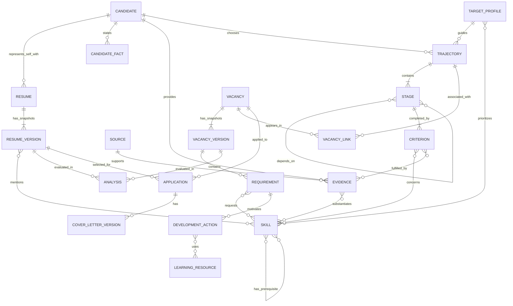

# Сущности и связи Career Intelligence

Дата: 22.10.2026. Область: локальный веб-сервис `tools/cv_matcher` на порту 8788. Это предметная модель; одна сущность здесь не обязательно соответствует отдельной SQL-таблице.

## Четыре исходных пункта — с уточнениями

1. **Карьерная траектория → этапы → критерии завершения.** Траектория описывает цель и маршрут. Этап имеет зависимости и проверяемые результаты.
2. **Навык ↔ критерий этапа.** Навык общий: он может быть нужен в нескольких траекториях, вакансиях и проектах. Сам навык не принадлежит одному CV.
3. **Вакансия → версия описания → требования.** У требования есть цитата, тип обязательности и происхождение анализа. Принадлежность компании не определяет траекторию.
4. **Кандидат → версии резюме + факты + подтверждения опыта.** Резюме представляет опыт; упоминание навыка в CV не является автоматически подтверждённым владением.

Нужны ещё самостоятельные понятия: **подтверждение**, **источник**, **целевой профиль компетенций**, **результат анализа**, **действие развития**, **отклик** и **связь вакансии с траекторией**.

## Схема предметной области

Стрелка `mentions` не означает `substantiates`. Связь `VACANCY_LINK` не означает полное соответствие кандидата. ER-схема показывает логические связи, а не наличие отдельных таблиц для всех стрелок.

## Сущности

| Сущность | Что описывает | Основные связи и правила |
|---|---|---|
| Кандидат / профессиональный профиль | Контакты, факты, проекты, опыт и цели одного владельца | В текущем сервисе владелец один; отдельная multi-tenant модель Candidate не введена |
| Резюме | Стабильная идентичность варианта CV | Имеет снимки; для каждой версии сохраняются источник и время |
| Версия резюме | Неизменяемый текст на момент сбора | Анализы и отклики ссылаются на точную версию; правка CV не изменяет прошлый снимок |
| Источник / дополнительный документ | CV, трудовая книжка, заметка, импортированный документ, ссылка на проект | Документ с датами — источник для сверки, а не автоматически достоверная история работы |
| Candidate Fact | Уточнение кандидата, например даты, обязанности или контекст проекта | Имеет происхождение; факт, написанный владельцем, не равен независимой проверке |
| Навык | Нормализованная компетенция | Многие-ко-многим с требованиями, критериями, профилями, доказательствами |
| Подтверждение навыка / результата | Выполненная работа, проект, эксперимент, обучение или оформленный результат | Имеет тип, состояние, текст/цитату, ссылку и версию. Отзывается без удаления истории |
| Целевой профиль компетенций | Набор навыков и их важность, например Generative Models Research | Сейчас в коде называется `track`; это профиль назначения, а не последовательность карьерных переходов |
| Карьерная траектория | Редактируемая цель и маршрут к ней | Имеет стабильный ID и версии, целевой профиль и этапы |
| Этап | Промежуточный результат маршрута | Зависимости образуют граф без циклов; завершение определяется критериями |
| Критерий | Проверяемое условие завершения | Навык, проект, опыт, обучение, переход или документ; связывается с доказательствами |
| Вакансия | Стабильная запись из конкретного источника | Имеет версии, состояние активности, компанию и исходную ссылку |
| Требование вакансии | Конкретный ожидаемый навык или результат | Цитата + `required / preferred / mentioned`, строгость, уверенность, версия извлечения. Упоминание не повышается автоматически до обязательного |
| Связь вакансии с траекторией | Целевая вакансия или объяснимое предложение соответствия | Многие-ко-многим; одна вакансия может быть на пересечении траекторий |
| Результат анализа / план навыков | Снимок сопоставления выбранных версий и подтверждений | Хранит контекст, версии данных/правил/моделей. Embedding similarity не равен владению навыками |
| Действие развития | `learn`, `practice`, `validate`, `document_in_cv`, `publish_project` | Выбирается по требованию и состоянию evidence; отсутствие данных ведёт к уточнению, не автоматически к обучению |
| Учебный ресурс | Материал или упражнение с предпосылками | Связывается с навыками; продвинутая тема учитывает основы |
| Отклик | Подготовка и история взаимодействия по вакансии | Выбранные версии CV/вакансии, варианты письма, анкета, этапы, сообщения и результаты |
| Задача сбора / анализа | Исполняемая работа и её состояние | Технический процесс, а не этап карьеры кандидата |

## Различия, которые важно сохранять

- **Категория вакансии** — рыночная специализация; **компания** — работодатель. Ни одна из них не является автоматически карьерной траекторией.
- **Целевой профиль** отвечает «какие компетенции нужны», **траектория** — «через какие результаты и этапы двигаться».
- **CV mention**, **профессиональная практика**, **проект**, **исследование**, **обучение** — независимые признаки.
- `unknown / not_confirmed` означает недостаток подтверждений. `explicit_gap` допустим при явном указании отсутствия опыта.
- Прохождение курса не закрывает практический критерий. Один выполненный проект может закрыть несколько критериев, если подтверждены соответствующие навыки.
- Изменение вакансии или подтверждения делает старый анализ историческим. Его нельзя молча выдавать за анализ текущих данных.
- Несколько CV с одинаковым опытом не создают несколько независимых подтверждений стажа.
- У вакансии могут быть несколько траекторий; отсутствие связи и невозможность анализа неполного текста — разные состояния.

## Фактическое хранение

Основной локальный архив — SQLite `state.sqlite3`. Перечисленные Stores — слои доступа к общей базе, а не независимые копии доменных сущностей.

| Данные | Реализация |
|---|---|
| CV / вакансии / снимки / история источников | `ArchiveStore`: `entities`, `versions`, `events`, `scans`, `membership` |
| Профили навыков | `career_skills_catalog.py`; пользовательские версии в `archive_meta`, ключи `career-skills:track:*` |
| Траектории / этапы / критерии | `career_trajectory.py`, JSON в `archive_meta`: `career-skills:trajectory:*`, `trajectory-version:*` |
| Подтверждения | `career_skills_store.py`, `career_skill_evidence.py`, `career_trajectory.py`; CV-specific annotations и общие owner evidence |
| Факты / дополнительные документы | `candidate_facts.py`, `candidate_profile.py`, `resume_supplements.py`, `resume_evidence.py` |
| Требования / планы развития | `career_skill_requirements.py`, `career_skills.py`; версионированные ключи кэша / планов в `archive_meta` |
| Подробные сопоставления CV ↔ вакансия | `skill_analyses`, `skill_analysis_sources`; API или ручной импорт результата без API |
| Векторы / рейтинги | `AnalysisStore`: `embedding_vectors`, `document_embeddings`, `ranking_runs` |
| Отклики / обсуждение | `ApplicationStore`, `CareerApplication`, workflow-модули; `applications`, `turns` и связанные хранилища |

`archive_meta` — существующий физический контейнер версионированных данных. Он не отменяет разделения сущностей на уровне доменной модели. Новые таблицы только ради ER-диаграммы не создаются.

## Реализованное состояние · 22.10.2026

Добавлены обязательные и дополнительные критерии маршрута, предложение адаптации существующей траектории к роли, плашки и фильтры вакансий по одной/нескольким траекториям с объяснением основания. Адаптация создаёт проверяемый черновик того же маршрута; сохранение повышает версию.

Явные цели находятся в `target_vacancy_ids` и `basis.vacancy_id` JSON траектории. Предлагаемые связи вычисляются из роли и навыков в `career_trajectory_matching.py`; отдельной таблицы `VACANCY_LINK` нет. Плашки и фильтры используют одну проекцию. Неразмеченная полная вакансия отличается от вакансии, для которой ещё нужно полное описание.

Базовый редактор траекторий, evidence feedback, локальный черновик по вакансии, сравнение CV и импорты источников уже реализованы. Независимая проверка проектов, гарантия найма и автоматический надёжный разбор всех произвольных требований не реализованы.

## Связанные документы и код

- [Архитектура локального сервиса](../tools/cv_matcher/docs/architecture/current-state.md)
- [Карьерная траектория](../tools/cv_matcher/docs/architecture/career-trajectory.md)
- [Skills Intelligence](../tools/cv_matcher/docs/architecture/skills-intelligence.md)
- [Разбор портфеля CV](../tools/cv_matcher/docs/architecture/resume-portfolio-review.md)
- [Слой приложения](../tools/cv_matcher/docs/architecture/application-layer.md)
- [ArchiveStore](../tools/cv_matcher/src/archive_store.py)
- [AnalysisStore](../tools/cv_matcher/src/analysis_store.py)
- [Модуль траекторий](../tools/cv_matcher/src/career_trajectory.py)
