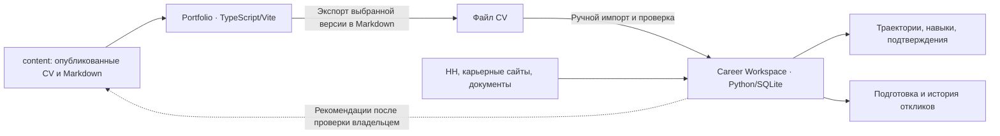

# Portfolio + Career Workspace

В одном репозитории два самостоятельных проекта с общей историей кандидата. `workspace.projects.json` — единый указатель их корней, точек входа, URL и владельцев данных. Перенос директорий не требуется для их разделения: текущие пути сохраняют сборку GitHub Pages, импорты и установленное Chrome-расширение.

## Проекты и владельцы данных

| Проект | Корень и точки входа | Владелец данных |
|---|---|---|
| Личное портфолио | `src/`, `content/`, `public/`, `index.html`; Vite, TypeScript | Публичные тексты CV и варианты представления |
| Career Workspace | `tools/cv_matcher/resume_import_server.py`, `archive-web/`, `src/`, `hh-research-extension/` | Частный архив CV/вакансий, факты, доказательства, траектории, анализы и отклики |
| Публичный AI demo API | `cv-api/` | Отдельный исторический endpoint; не backend локального Career Workspace |
| Workday companion | `autofill-extension/` | Legacy-инструмент, не исполнитель очереди Career Workspace |

Рекомендация об изменении CV в локальном сервисе не меняет публичное `content/`. Импорт из портфолио не превращает публичное упоминание навыка в проверенный профессиональный опыт. Архив сохраняет снимок: последующие изменения опубликованного CV переносятся повторным импортом.

## Общие команды из корня

Для текущей версии Vite нужен Node.js 20.19+ или 22.12+ (либо более новая поддерживаемая ветка). Предварительно установить зависимости портфолио (`npm install` / `bun install`) и локального сервиса (`cd tools/cv_matcher && uv sync`). Команды не устанавливают расширение и не отправляют отклики.

| Команда | Действие |
|---|---|
| `npm run workspace:list` | Показать проекты и URL |
| `npm run workspace:check` | Проверить объявленные пути и точки входа |
| `npm run portfolio:dev` | Запустить Vite, `http://127.0.0.1:5173/` |
| `npm run portfolio:build` | Проверить TypeScript и собрать публичный сайт |
| `npm run portfolio:preview` | Просмотреть production-сборку |
| `npm run portfolio:test` | Проверить контракт экспорта CV в Markdown |
| `npm run career:dev` | Запустить локальный сервис на `127.0.0.1:8788` |
| `npm run career:test` | Изолированные тесты сервиса без production `.cache` / `.env` |
| `npm run career:check` | Сборка адаптеров, синтаксис и JS-тесты расширения |

Старые `dev`, `build`, `preview` оставлены совместимыми. Сервер `tools/cv_matcher/server.py` и страницы `matcher.html` / `scrape.html` относятся к прежнему пути; для персонального архива запускается `resume_import_server.py`.

## Перенос выбранного CV

В локальной dev-версии портфолио: **Экспорт → В подготовку откликов · Markdown**. Экспорт использует тот же `buildMarkdown`, что и обычное скачивание, с выбранными языком, профессиональным профилем и полнотой описаний. Открывается раздел «Резюме» локального сервиса; скачанный файл нужно выбрать в существующем импорте и проверить перед сохранением.

Это перенос файла с явной проверкой, а не скрытая синхронизация. При первом входе сервис потребует обычное локальное подключение. В production-портфолио owner-only кнопка перехода к localhost не показывается.

Из Career Workspace доступна ссылка на опубликованное портфолио. Она берётся из общего manifest. Токены, база и частные факты не передаются публичному сайту.

## Границы разработки

- Изменения публичного CV: `content/` и renderer/export портфолио.
- Изменения карьерной модели: `tools/cv_matcher/src/`, затем `archive-web/`; общий каталог навыков и evidence не копируются в публичный frontend.
- Browser automation: основной executor `hh-research-extension`; адаптеры и очередь согласуются с backend. Не смешивать manifests двух расширений.
- `dist/` — производная сборка, `.cache` / `.auth` / `.env` — локальные данные. Публичная сборка не должна импортировать их.
- Общий формат переносимого CV — Markdown. В частном сервисе он становится версионированным источником, не живой ссылкой на `content/`.

[Сущности и связи](career-domain-model.md) · [Документация сервиса](../tools/cv_matcher/docs/README.md) · [Карта репозитория](../REPOSITORY_MAP.md)
