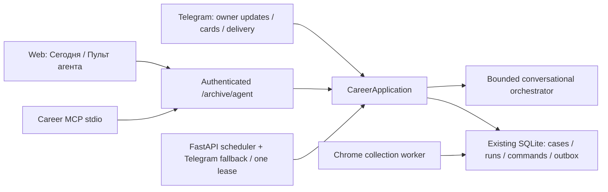

# Общий application layer и Career MCP

Обновлено 22.10.2026. Общий слой реализован; текущие версии расширения и health — в [README](../README.md). Задачи также включают `analysis:…` для Luna batch. Ручные отметки откликов — отдельные локальные наблюдения, не receipt площадки. Широкого LLM planner и универсального company submit нет.

[CareerApplication](../../src/career_application.py) владеет поиском, отбором рекомендаций, расписанием, outbox событий/напоминаний, созданием карточки отклика, подготовкой формы, чтением анализа и offline-пакетов. Правила CRM, версий, вопросов и одноразовых подтверждений остаются в существующих `ApplicationStore`/mixins. [WorkflowBot](../../src/workflow_bot.py) наследует общий сервис для совместимости, обрабатывает private owner-only Telegram updates, рендерит карточки и доставляет durable outbox. Бизнес-логика расписания больше не требует живого Telegram long poll.

[career_runtime](../../src/career_runtime.py) запускается в lifespan существующего FastAPI; бот сохраняет fallback tick. Общая renewable SQLite lease допускает только одного владельца scheduler tick. Перезапуск или недоступность одного клиента не удаляет операции. Отдельный сервис, БД или message broker не добавлены.



## Общий API

`GET /archive/agent` возвращает состояние и задачи. `POST /archive/agent` принимает `op`: `search`, `converse`, `tasks`, `get_task`, `control_task`, `prepare_application`, `get_application`, `review_action`, `rank`, `analyze`. Обработчики — [agent_routes.py](../../src/agent_routes.py). Используется прежний pairing token или web session с проверенным Origin для POST. Токен не попадает в промпт/tool result. `next/claim/result/approve` здесь отсутствуют. Существующие `/archive/workflow` make/prepare/discovery_start делегируют общему сервису.

Система локальная и однопользовательская: Telegram проверяет owner и private chat; Web/MCP действуют с полномочиями локального владельца. Отдельного multi-user principal/tenant isolation не добавлено. MCP вызывает только фиксированный loopback backend, не следует redirects и не использует proxy environment. Документы CV/JD не превращаются в команды.

## Conversation

[career_orchestrator.py](../../src/career_orchestrator.py) — общий ограниченный router, без платного LLM вызова. Поддерживает «найди вакансии», «мои задачи», «статус», «подготовь отклик hh_123», «пауза search:ID», «продолжи search:ID», «отмени search:ID». Неизвестный запрос уточняется. Фраза об отправке ведёт к человеческому preview, без разрешения/submit. Широкое многозадачное LLM planning/reasoning остаётся будущим расширением этого слоя.

`request_id` сохраняется с hash и ответом в `settings`; повтор возвращает прежний ответ. Прерванный запрос не выполняется автоматически ещё раз. Изменённый текст с прежним ID отклоняется. Search имеет отдельный durable digest key, переиспользует активный run и восстанавливает orphan run после crash между start и pending_digest.

В Telegram: `/tasks`, `/pause search:ID`, `/resume search:ID`, `/cancel search:ID`; кнопки управления содержат ID и revision. `/cancel` без ID по-прежнему отменяет ввод; `/pause` без ID остаётся командой существующего Giga controller. Режимы редактирования и ответа Giga не перехватываются router. Основное меню сохраняет три пункта; задачи доступны через «Система и настройки» и `/tasks`.

## Pause/resume/cancel

[agent_tasks.py](../../src/agent_tasks.py) — общий versioned контракт. ID имеет вид `search:<run_id>` или `browser:<command_id>`. Task snapshot содержит `state`, `revision`, `actions`, progress. Клиент показывает только доступные `actions`; stale revision отклоняется транзакционно. История controls сохраняется с actor в `agent_task_events`, уведомления идут в прежний outbox.

| Операция / стадия | Контроль |
|---|---|
| Поиск, Chrome ещё не взял команду | `waiting_chrome` без истечения по десятиминутному ожиданию; pause/cancel, автоматическое начало после появления worker |
| Поиск / сбор полных описаний в Chrome | `pause_requested` / `cancel_requested`; worker проверяет control каждые 1,5 секунды и останавливает crawl на ближайшей безопасной границе |
| Рейтинг discovery | Остановка между пакетами до 200 вакансий; текущий запрос не прерывается. Offset, CV/JD hashes и counters сохраняются; resume не повторяет завершённые пакеты |
| Прерванный/неподтверждённый model request | `needs_input`; не автоматический resume/retry платного запроса |
| Самостоятельный collect | Pause/cancel чтения; resume создаёт новый command ID, старый receipt остаётся неизменным |
| Иные browser read/prepare в очереди | Pause/cancel до claim. Running sync/prepare пока без cooperative stop |
| Execute/career_fill до claim | Только cancel с отзывом разрешения |
| Claimed write / sending / uncertain / submitted | Отмена недоступна. Нужна сверка фактического результата; нельзя обещать отменить уже раскрытые данные |

После паузы посередине источника возобновление начинает этот источник заново с уже сохранённым JD/cache; точный DOM/page checkpoint пока не переносится в новый crawl. Завершённые данные не стираются. Нельзя остановить уже выполняющийся navigation/HTTP/model вызов мгновенно. При потере worker heartbeat не производится новая отправка. Пауза отдельной задачи не выключает всё повторяющееся расписание; для автосинхронизации есть отдельная настройка.

State/checkpoints находятся в существующих `discovery_runs` и `browser_commands`; controls/audit/leases — новые небольшие таблицы в той же SQLite. В backup включены controls и audit; lease не экспортируется.

## MCP

[career_mcp.py](../../career_mcp.py) использует официальный Python SDK `mcp==1.30.0` как optional extra. SDK установлен в существующую `.venv`; lockfile обновлён без изменения прежних версий. Установка на другом компьютере: `uv sync --extra mcp`.

Запуск из каталога проекта:

```sh
.venv/bin/python career_mcp.py
```

Это stdio-процесс, который запускает MCP-клиент. Он не должен работать как отдельный HTTP daemon. Локальный веб-сервис `resume_import_server.py` должен быть запущен. Пример client config (токен в него не копировать):

```json
{
  "mcpServers": {
    "career": {
      "command": "/Users/vladmac/Code/Bots-Automation/Node-Tools/NodeJS/Misc-Projects/vladislav-vasilenko.github.io/tools/cv_matcher/.venv/bin/python",
      "args": ["/Users/vladmac/Code/Bots-Automation/Node-Tools/NodeJS/Misc-Projects/vladislav-vasilenko.github.io/tools/cv_matcher/career_mcp.py"]
    }
  }
}
```

Конфигурация внешних клиентов автоматически не изменялась. Реальные tools:

- `career.get_state`, `career.converse`;
- `career.search`, `career.get_task`, `career.control_task`;
- `career.rank`, `career.analyze`;
- `career.prepare_application`, `career.get_application`, `career.review_action`.

Search использует только сохранённые владельцем источники/лимиты/режим API из существующих настроек поиска. MCP не может включить API аргументом. `rank` использует готовые vectors, до 200 явно выбранных вакансий за вызов; `analyze` — cached/offline. Платные Luna/письма доступны из прежних явных действий Web/Telegram/extension. Отдельный bounded budget policy для платных MCP операций пока не добавлен. Нет tools SQL/eval/claim/result/approve/send. Даже `review_action` только читает case и возвращает ссылку на пульт. Существующие проверки TTL/версии/одноразовости отправки сохранены.

## Проверка

[test_career_agent.py](../../src/tests/test_career_agent.py): межклиентское продолжение, restart, stale revision, cooperative pause, checkpoints 200+5, отсутствие повторной оплаты, безопасность claimed writes, owner-only Telegram, Giga input, API auth/Origin, scheduler lease, настоящий SDK client/server protocol и stdio initialize/list_tools. [discovery.test.mjs](../../hh-research-extension/discovery.test.mjs) проверяет polling, отсутствие navigation после предварительной паузы и sync частичных данных перед receipt. Старые regression suites также обязательны.

## Ожидание Chrome и сообщения прогресса

Queued discovery не истекает через 10 минут: время в очереди не считается временем выполнения. `waiting_chrome` хранится в SQLite, `/today` возвращает ту же задачу, расписание не создаёт очередь одинаковых подборок. Свежий heartbeat/claim переводит run в сбор автоматически. Зависший read-only discover после потери heartbeat заменяется новой командой; поздний receipt старой принимается как ignored и не завершает новую. Пауза пользователя не снимается после пробуждения. Claimed writes и платные model requests не перезапускаются; срок согласования при сне не продлевается.

Это определяется отсутствием связи, а не достоверным датчиком крышки ноутбука. При полном сне локальные Python/Chrome не исполняются. После пробуждения сохранённая задача продолжится; непрерывная работа при выключенном ноутбуке требует отдельного размещения.

[agent_progress.py](../../src/agent_progress.py) принимает только ограниченные числовые counters от текущего browser worker. HH/company crawls передают найденные карточки, план описаний после cache-filter, прочитанные полные тексты, cache reuse, ошибки, закрытые/требующие проверки. Пока выдача не прочитана, общее число уточняется. Для нескольких источников полный итог планирования известен только после их выдач; учитываются выбранные pages/details, не все вакансии сайта. Счётчики относятся к последнему проходу каждого источника; повтор после сна может начать проход заново с сохранённым кэшем.

SQLite `browser_command_progress` хранит последний sequence/snapshot для команды. Поддельный worker, старый sequence, отрицательные/лишние поля отклоняются или игнорируются. Прогресс не запускает API модели. В вебе/MCP читаются те же counters.

Telegram редактирует первоначальное сообщение `digest_key:progress`, используя durable `workflow_delivery.message_ids`. Обновление проверяется раз в 5 секунд, редактирование — не чаще 10 секунд и только при изменении текста. После restart сохраняются message ID/hash/backoff. Неподтверждённая отправка progress не создаёт дубликат, удалённое сообщение не пересоздаётся автоматически. Telegram 429 учитывает retry_after. Доставка обычных рекомендаций/ответов сохраняет прежний outbox. Тесты: [test_agent_progress.py](../../src/tests/test_agent_progress.py).

Живые отклики, ответы рекрутерам и платные model запросы в этих проверках не выполняются. Giga TTL унификация (G26), полная provenance chain (G23), controlled live sleep/recovery для G02 и универсальный company submit остаются отдельной работой.
