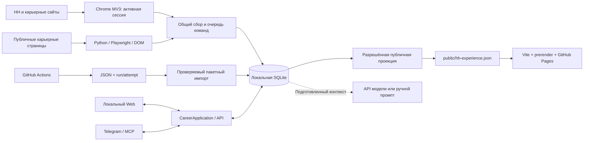

# Фактическая архитектура

Срез исходников: **22.10.2026**. Исторический аудит с первоначальными наблюдениями перенесён в [handoff](../handoff/2026-10-19-architecture-audit.md). Этот документ описывает текущие компоненты; планы вынесены в [roadmap](../roadmap.md).

## Компоненты и ответственность

| Компонент | Код | Ответственность |
|---|---|---|
| Локальный API, порт 8788 | [resume_import_server.py](../../resume_import_server.py) | Авторизация, маршруты, lifespan фоновых задач |
| Архив и анализ | [archive_store.py](../../src/archive_store.py), [analysis_store.py](../../src/analysis_store.py) | Версии CV/JD, наблюдения, векторы, рейтинги и источники |
| Карьерный workflow | [career_application.py](../../src/career_application.py), [application_store.py](../../src/application_store.py) | Общие задачи Web/Telegram/MCP, CRM и согласования |
| Веб-интерфейс | [archive-web](../../archive-web/) | Сегодня, вакансии, аналитика, CV, траектории, отклики, настройки |
| Исполнитель Chrome MV3 | [manifest](../../hh-research-extension/manifest.json) | Чтение доступных страниц и исполнение поддержанных команд в сессии владельца |
| Гибридный сбор | [hybrid_collection.py](../../src/hybrid_collection.py), [collection_policy.py](../../src/collection_policy.py) | Выбор Python/Chrome, ограниченный fallback и диагностика |
| Дозагрузка описаний | [collection_backfill.py](../../src/collection_backfill.py) | Сохранённая очередь, попытки, пауза, результаты по источникам |
| Telegram и MCP | [telegram_recruiter.py](../../telegram_recruiter.py), [career_mcp.py](../../career_mcp.py) | Клиенты общего backend; не отдельные CRM |
| GitHub collection | [github_collection_import.py](../../src/github_collection_import.py), [github_collection_control.py](../../src/github_collection_control.py) | Управление Runs и импорт артефактов порциями |
| Публичная проекция | [portfolio_publication.py](../../src/portfolio_publication.py), [portfolio_visuals.py](../../src/portfolio_visuals.py) | Выбранные публичные поля, введение, исследования и обезличенные визуализации |
| Портфолио | [корневой src](../../../../src/), [content](../../../../content/) | TypeScript/Vite, статические EN/RU страницы, SPA-переключения, PWA |

## Данные и идентичность

Основное хранилище: `.cache/applications/state.sqlite3`. В нём архивные `entities`/`versions`, receipts, membership и наблюдения источников, embedding vectors/bindings, ranking runs, разборы, CRM, browser commands, task events и outbox. Версионируемые настройки траекторий, навыков и публичной проекции используют существующий `archive_meta`. [Модель сущностей](domain-model.md).

Источник, канонический ID/URL, версия и hash относятся к данным, а не к текущей вкладке. Повторный импорт не создаёт дубль той же сущности. Старое или неполное описание не заменяет более свежий полный текст. Отсутствие в неполной выдаче не закрывает вакансию.

Текущий персональный рейтинг использует векторы SQLite. ChromaDB в старом pipeline остаётся отдельным производным индексом; переносить в него CRM или разрешения не требуется. Старый `server.py:8787`, `cv_matcher.py`, `cv-api/`, `matcher.html` и `scrape.html` не заменяют API 8788. [ADR о хранилищах](adr/0002-sqlite-and-chroma.md).

## Сбор и адаптеры

Основное расширение — `hh-research-extension` **0.12.0**, health API **14**, collection protocol **2**. Версия исходников не подтверждает обновление загруженного worker. Legacy `autofill-extension` — отдельный Workday companion, не исполнитель общей очереди.

| Источник | Гибридный локальный контур | Ограничение |
|---|---|---|
| HH | Chrome, доступные CV/выдача/детали/наблюдения | Нужны сессия и heartbeat; полнота обхода фиксируется явно |
| Yandex, Sber, Avito, Ozon, T-Bank | Python → Chrome или обратный порядок | Реальные фильтры, permissions и качество результата проверяются по адаптеру |
| Google, Meta | Python | Chrome fallback для них в текущем контуре отсутствует |
| LinkedIn | Отдельный раздел и адаптеры активной Chrome-сессии: профиль, вакансии, чаты, контакты | Живое чтение и полнота секций проверяются отдельно; profile-save/network не исполнялись в живой проверке |

Четыре режима: `python_first`, `chrome_first`, `python_only`, `chrome_only`. Код выбирает только поддержанный транспорт. Неподдержанный фильтр не удаляется молча. Fallback ограничен; сетевые повторы имеют backoff, блокировка доступа требует участия пользователя. Сбор не запускает LLM. [Подробный контракт](hybrid-collection.md).

Короткие карточки и полные JD имеют разные статусы качества. Дозагрузка живёт отдельно от поиска и рейтинга; UI показывает текущий прогресс, ошибки и причины ожидания. Расширение при подключённом сервисе передаёт большие описания в SQLite, снижая зависимость от quota `chrome.storage.local`.

## Траектория, CV и доказательства

`?view=learning` — **Карьерная траектория**. Цель и этапы не требуют предварительно выбранного CV. Маршрут редактируется с сохранением ID и проверкой revision; этапы закрываются критериями и подтверждениями навыков, проектов, опыта, обучения или перехода. CV и вакансии подбираются для этапа. Обязательные критерии отделены от дополнительных специализаций.

Вакансии показывают целевые/предложенные связи, пересечения и отсутствие разметки; фильтрация выполняется до пагинации. Связь по эвристике не равна экспертной оценке пригодности. Активная траектория пока не меняет автоматически общее расписание поиска или платные рейтинги.

Резюме сравниваются локально как документы с потоками параграфов либо как разделы. Отдельный разбор 2–7 снимков и дополнительных документов выбирает основу CV под профиль и проверяет хронологию: Luna/Terra через API либо копирование полного промпта и импорт проверяемого JSON. Контекст фиксирует версии; исходные CV не переписываются. [Сравнение](../integration/resume-comparison.md), [портфельный разбор](resume-portfolio-review.md).

Owner-confirmed evidence, цитата в CV, прохождение курса и публичная ссылка на GitHub — разные виды сведений. Автоматического доказательства качества проекта или исследовательского уровня нет. [Skills engine](skills-intelligence.md).

## Рейтинг и модели

Семантическая близость к CV и к цели, покрытие требований в подробном разборе и карьерная ценность — разные показатели. Ни один не является вероятностью собеседования. Кэш зависит от текста, версии, цели и модели; старый результат не подставляется за актуальный.

Локальное сравнение, просмотр, планы навыков, копирование промптов и публичные визуализации не вызывают модели. Новые embeddings, Luna/Terra разборы и генерация письма имеют отдельные действия. Единого учёта paid attempts для всех исторических model paths пока нет. Сохранённый отчёт можно читать без повторного запроса.

## Исполнение и доступность

`CareerApplication`, scheduler с SQLite lease, bounded conversational router, task control и MCP уже реализованы. Web/Telegram/MCP используют общие задачи. MCP не предоставляет произвольный SQL/eval/submit. [Контракты application layer](application-layer.md).

HH-отправка имеет prepare → preview → конкретное одноразовое разрешение → execute → проверка результата. Неопределённый результат не повторяется слепо. Для корпоративных форм есть чтение и поддержанное заполнение; универсальной автоматической отправки нет. Для LinkedIn реализован перенос проверенных полей открытого редактора и отдельное сохранение; живая запись ещё не проверена.

Локальная система работает при доступном компьютере. Сохранённая очередь и возобновление после сна не равнозначны круглосуточному исполнению. GitHub Actions может собирать публичные вакансии отдельно; перенос результата в SQLite требует запущенного локального импортера.

## Публичный сайт и приватность

Основной HH-CV определяется `summary.primary_id`. Title и опыт публикуются из его полного снимка; введение берётся из HH либо из проверенной редакции RU/EN, связанной с источником. Публичное образование пока берётся из контента портфолио, а не из HH-проекции. Обратная запись в HH не реализована; LinkedIn использует отдельный согласованный перенос в формы.

Опциональная проекция добавляет выбранное направление, изучаемые темы, публичные лаборатории и обезличенную выборку рынка. Подтверждённая практика отделена от обучения. CRM, трудовые документы, raw model reports, индивидуальные оценки соответствия и SQLite не публикуются. [Синхронизация](../integration/github-import-and-portfolio.md), [публичный контракт](../integration/public-portfolio.md).

## Проверка и оставшаяся работа

Изолированные tests проверяют локальные контракты, версии, receipts, модели с подменами и негативные сценарии. Они не гарантируют работу внешнего DOM после очередного редизайна. Текущие команды и таблица проверок: [operations](../operations.md). Известные ограничения: [gap analysis](gap-analysis.md).

Следующий согласованный этап — [LinkedIn adapters](../integration/linkedin-adapters.md): собственный профиль и рекомендации вакансий из активной сессии, затем пакетные JD и проверяемые переходы Apply. Текущий статус каждой capability и оставшиеся проверки описаны по ссылке.
