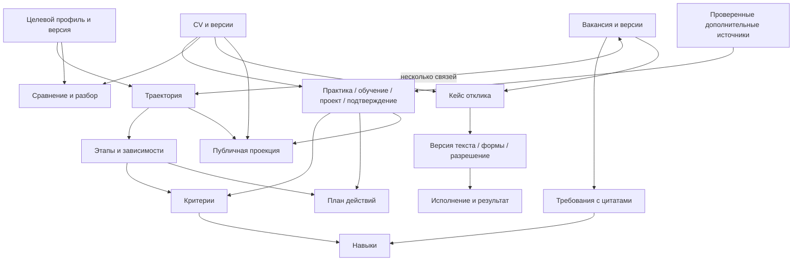

# Сущности и связи

Срез 22.10.2026. Это логическая модель поверх существующей SQLite, не предложение создать отдельную таблицу для каждого термина. Подробная корневая схема: [career-domain-model.md](../../../../docs/career-domain-model.md).

| Сущность | Смысл и связи | Реализация |
|---|---|---|
| Целевой профиль / track | Версия набора приоритетных навыков; основа траектории и анализа | `career_skills_catalog.py`, `career_skills_store.py` |
| Траектория / stage / criterion | Цель, порядок/зависимости, required/preferred и критерии результата | `career_trajectory.py`, versioned `archive_meta` |
| Навык / требование | Нормализованный skill и его упоминание/обязательность в конкретной версии JD | `career_skill_requirements.py` |
| Evidence | Цитата, owner-подтверждение, проект, работа или обучение; provenance отдельно от оценки | `career_skill_evidence.py`, `career_trajectory.py` |
| Резюме / snapshot | Идентичность CV и неизменяемые версии текста | `ArchiveStore`, `entities`, `versions` |
| Дополнительный источник | Проверенный текст документа/заметки, не автоматически факт или новое CV | `resume_documents.py`, `resume_portfolio.py` |
| Вакансия / snapshot | Source ID/URL, карточка/полный текст, качество и наблюдения активности | `ArchiveStore`, `board_import.py` |
| Связь вакансии и пути | Явная целевая либо эвристическая предложенная; несколько путей допустимы | `career_trajectory_matching.py` |
| План навыков | Версия расчёта по cohort/этапу, CV/track/evidence и ближайшим действиям | `career_skills.py`, `archive_meta` |
| Embedding / ranking | Кэш по тексту/модели и результат по выбранному контексту | `embedding_vectors`, `document_embeddings`, `ranking_runs` |
| Review / analysis | Версионированный контекст, источники, model/offline ответ и проверки | `resume_review.py`, `skill_analysis.py` |
| Application / draft / form | Кейс кандидата, версии письма и снимок формы | `ApplicationStore` и workflow mixins |
| Intent / approval / receipt | Конкретное согласование, одноразовое исполнение и наблюдаемый результат | `application_workflow.py`, browser workers |
| Run / command / task / event | Discovery, browser queue, прогресс, контроль, доставка | `discovery.py`, `agent_tasks.py`, `agent_progress.py` |
| GitHub import / publication | Курсор run/attempt и отдельная разрешённая публичная проекция | `github_collection_import.py`, `portfolio_publication.py` |

Траектория не принадлежит одному CV: этап сравнивает разные CV и подбирает основу. Один навык участвует в нескольких путях, а одна вакансия может пересекать несколько траекторий. Evidence может закрывать несколько подходящих критериев, но статус практики не получается автоматически из учебного курса.

Основное CV — выбор источника, а не копия всех данных кандидата. Профиль контактов, Candidate Facts, карьерная цель, редактируемая траектория и публичное введение — разные сущности. Название должности на публичном сайте не должно браться из случайной версии шаблона.

Планируемые LinkedIn snapshot/patch/apply metadata расширяют эту модель с provenance и версиями; пока они не являются сохранёнными сущностями основного расширения. [Контракт следующего этапа](../integration/linkedin-adapters.md).
