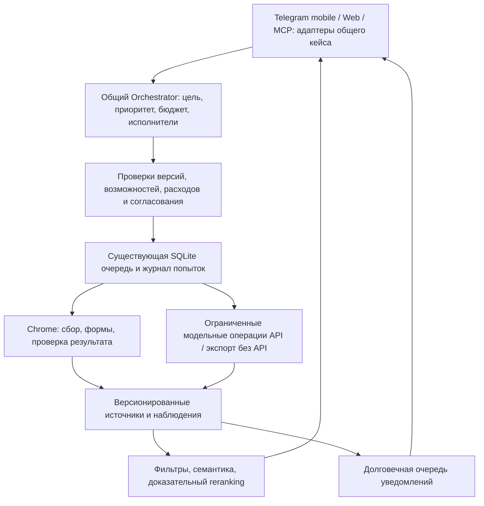

# Целевая архитектура: развитие существующего конвейера

> **Обновление Skills Intelligence, 20.10.2026:** [реализованный модуль, контракт, использование и ограничения качества](skills-intelligence.md). 33 навыка / 6 версионируемых треков, общие Web/Telegram рекомендации по top-K, evidence feedback и история; 369 Python / 320 JS. Live Web: 50 вакансий, API 0. Независимая массовая разметка и аудит GitHub остаются дальнейшей работой. Эта фаза реализована по отдельному явному запросу пользователя; исторический baseline ниже сохранён.

> **Вход в следующее планирование, 20.10.2026:** [Отчёт для следующего планирования — 20.10.2026](../handoff/2026-10-20-agent-planning-brief.md). Этот документ остаётся целевой архитектурой; готовность частей сверять с отчётом. Telegram Primary, существующий MCP stdio/Telethon, новые batch/manual-mark/analytics не создавать заново. Career Value/детерминированная очередь, role/technology/domain axes и embedding classifier пока предложения, а не работающая система.

> Обновление аналитики и Telegram 19.10.2026: [Sankey, фокус, исправление Apple-тегов, единый топ-10 и подробный разбор](../integration/career-analytics-telegram.md). Политика топ-10 и пометки ⭐ в этом отчёте заменяет прежние правила короткой подборки.

> Обновление 19.10.2026, API 13 / Extension 0.11.16: [сквозная интеграция Telegram, исправления, 305 Python / 292 JS и оставшиеся ограничения](../integration/telegram-career-e2e.md). Исторические записи ниже описывают состояние на момент аудита, не отменяют уточнений в этом отчёте. Полный live E2E всех компаний не объявлен готовым.

> Обновление после аудита, 19.10.2026: общий `CareerApplication`, backend scheduler с SQLite lease, bounded conversational router, versioned task control и MCP stdio реализованы. Фактические контракты, ограничения и запуск: [Общий application layer](application-layer.md). Исторические findings ниже описывают baseline аудита; G22/G24/G25 закрыты в указанном объёме, G27 — для поддержанных стадий. G23/G26 остаются открыты.

Дата: 19 октября 2026. Статус: **проектное предложение**, не описание уже реализованных функций. Основание: [фактическая архитектура](current-state.md) и [разрывы](gap-analysis.md). Порядок внедрения: [roadmap](../roadmap.md).

## 1. Архитектурное решение

Главный приоритет — интеграция уже существующих возможностей. Зафиксированы [ADR reuse workflow](adr/0001-reuse-existing-workflow.md), [ADR SQLite/Chroma](adr/0002-sqlite-and-chroma.md), [ADR тонкого MCP и согласования](adr/0003-thin-mcp-and-human-approval.md), [ADR доступности](adr/0004-local-availability.md). Первое внешнее управление: MCP → bounded Career Agent planning → existing discovery/ranking → Luna analysis → CRM → Chrome prepare queue → human approval. MCP — адаптер к домену, а не второй backend.

По требованию владельца **Telegram — основной мобильный Career Agent Control Interface**: conversational requests, notification center, human-in-the-loop и workflow control. [ADR 0005](adr/0005-telegram-primary-control.md) фиксирует исследованную основу, недостающие функции и межклиентский contract. Telegram Bot, MCP Server, Chrome Extension и Web Dashboard — независимые адаптеры общего application layer. Career Agent не реализуется внутри Telegram-бота.

Сохранить локальный модульный монолит: существующий FastAPI `:8788`, один SQLite-файл, процесс Telegram и Chrome Extension как browser executor. Развивать [ArchiveStore](../../src/archive_store.py), [ApplicationStore / WorkflowMixin](../../src/application_store.py), [discovery.py](../../src/discovery.py), [WorkflowBot](../../src/workflow_bot.py). Не добавлять отдельные микросервисы, Redis/Celery, новую vector DB, Kubernetes или agent framework ради названия «агент».

Интеллект системы — в качественном контексте, выборе следующего действия, объяснимом отборе и надёжном завершении задач. LLM предлагает классификации, вопросы, письма и план; детерминированный policy layer проверяет данные, бюджет, возможности адаптера и требуемое разрешение. Модель не получает cookie HH, токен локального API или произвольный инструмент выполнения JavaScript.

Названия блоков диаграммы обозначают обязанности. Новых production modules/endpoints с этими названиями сейчас нет. Новые файлы и таблицы ниже — предложения; их добавление требует конкретного migration/test change.

## 2. Границы внутри существующего проекта

| Обязанность | Переиспользовать | Изменить постепенно |
|---|---|---|
| Источники и identity | [board-core.js](../../hh-research-extension/board-core.js), [adapters/runtime.js](../../hh-research-extension/adapters/runtime.js), [board_import.py](../../src/board_import.py), [collection_contract.py](../../src/collection_contract.py) | Общий manifest capabilities и contract fixtures JS/Python; не объединять разный DOM насильно |
| Канонический архив | [ArchiveStore](../../src/archive_store.py), [AnalysisStore](../../src/analysis_store.py) | Версионированные миграции, provenance, явная freshness policy, связи похожих записей |
| Профиль/контекст | [resume_source.py](../../src/resume_source.py), [candidate_profile.py](../../src/candidate_profile.py), [candidate_facts.py](../../src/candidate_facts.py) | Один контракт context identity; различать CV, новые утверждения владельца, цели и контакты |
| Поиск/планирование | [discovery.py](../../src/discovery.py), [hh_auto_sync.py](../../src/hh_auto_sync.py), [WorkflowBot.tick](../../src/workflow_bot.py) | Ожидание спящего исполнителя, recovery, зафиксированный scope, понятные причины исключения |
| Решения моделей | [skill_analysis.py](../../src/skill_analysis.py), [cover_letter.py](../../src/cover_letter.py), [recruiter_answers.py](../../src/recruiter_answers.py), [resume_review.py](../../src/resume_review.py) | Общая политика попыток/бюджета и API/без API; доменные schemas сохранить |
| Выполнение отклика | [WorkflowMixin](../../src/application_workflow.py), [CareerFieldsMixin](../../src/career_application_fields.py), [hh-workflow.js](../../hh-research-extension/hh-workflow.js), [career-workflow.js](../../hh-research-extension/career-workflow.js) | Общие стадии, раздельные site executors, проверка успеха и неизвестного результата |
| Пульт | [archive-web/workflow.js](../../archive-web/workflow.js), [WorkflowBot](../../src/workflow_bot.py), [journey.py](../../src/journey.py) | Один следующий шаг, одни данные/версии, компактные Telegram-карточки |

Старый `:8787` и Chroma путь явно обозначить как отдельный. Уже имеющийся вызов `collection_contract` из `BaseScraper.fetch_jobs` проверить на supported company collections, provenance и стабильность IDs; не создавать повторный importer. Только после проверки эквивалентности устранять дублированные алгоритмы. Массовая миграция Chroma→SQLite или обратно до установления назначения/происхождения данных не допускается; нынешние решения сохраняют оба назначения.

## 3. Контракты данных и состояния

### Контекст и происхождение

Сохранить source-specific vacancy IDs и неизменяемые версии. Целевой контекст операции содержит выбранный `resume_id + resume_hash`, vacancy ID/hash/version, goal, факты пользователя с происхождением, comments, model alias, prompt/schema version и режим API. Конкретный состав hash должен быть опубликован и одинаково проверяться всеми путями. Учитывать изменения user facts и prompts, но не оплачивать их автоматически: сначала показывать, почему старый результат больше не подходит.

Разделить время получения полного JD, время появления в выдаче и время проверки доступности. В policy применять:

- полный текст переиспользуется до суток, как выбрал пользователь;
- изменившийся snippet/title/date, force или подозрение на drift требуют refresh;
- перед рекомендацией/отправкой проверять активность кандидатов shortlist; не перечитывать весь архив ради малого числа рекомендаций;
- отсутствие в выдаче не подтверждает закрытие; неизвестное остаётся неизвестным;
- восстановление из SQLite сохраняет те же freshness markers и не «омолаживает» документ.

### Связи похожих вакансий

Добавить небольшую relation/group таблицу **в ту же SQLite**, а не новую БД. Поля проектного контракта: source members, relation type (`same_posting` / `similar_role` / `uncertain`), evidence, score, model/document versions, подтверждение/отклонение владельца.

Сначала искать candidates внутри нормализованной компании/сопоставимого семейства ролей, затем использовать уже рассчитанные векторы одной модели и сравнить название, локацию, обязанности, source requisition ID. Высокая cosine — сигнал, не доказательство одной вакансии. Порог подобрать по размеченным парам. Не применять транзитивное объединение A≈B≈C без проверки A↔C; не ограничивать алгоритм искусственно ровно 2–3 членами.

По предпочтению пользователя **не блокировать отклики в разных источниках**. Показывать связанные записи и историю действий по каждой; source application остаётся независимым. Согласование одной записи никогда не разрешает отправку в другую.

### Очереди и побочные эффекты

Развивать `browser_commands` и receipts, сохранив single-use approvals. Требуется явная классификация:

| Тип операции | При потере исполнителя/ответа |
|---|---|
| Чтение источника | Ограниченный retry с lease/backoff, сохранением прогресса и source scope |
| Embedding/LLM API | Сначала durable attempt и budget claim; не считать потерю ответа бесплатной; cache/reconcile перед повтором |
| Перенос данных в форму | Привязка к сайту, вкладке, CV, form/profile revision; неопределённость требует проверки |
| Отправка отклика/ответа | Конкретное разрешение и одноразовый claim; неизвестный результат не повторять вслепую |
| Уведомление владельцу | Outbox + receipts; явный reject допускает отложенный retry, ambiguous transport — сверку |

Нужен единый correlation ID цепочки `discovery → ranking → application → command → event → delivery`. In-memory busy flags остаются локальной оптимизацией, не источником истинности. Site mismatch, конфликт Giga и нераспознанный DOM должны создавать диагностируемый partial/requires-review, не скрытый успех.

## 4. Ранжирование и персональная интеллектуальность

Построить каскад на имеющихся алгоритмах:

1. Детерминированные constraints: подтверждённая активность, source coverage, предпочтения компании, формат/локация, явные ограничения пользователя. Неизвестные salary/seniority не превращать в выдуманные значения.
2. Имеющиеся cached embeddings — быстрый shortlist всего выбранного scope; пакетный проход с глобальной сортировкой и прогрессом.
3. Доказательный разбор небольшого shortlist через существующий `skill_analysis`; API только по выбранной политике расходов, либо экспорт/импорт без API.
4. Раздельно показывать семантическую близость, покрытие требований по CV, соответствие целям и неопределённость. Нельзя складывать несопоставимые значения как «вероятность найма».
5. Сохранять feedback владельца: полезна/нерелевантна/откликнулся/почему. После накопления данных оценить улучшения правил и reranking на holdout.

До внедрения новой модели измерить текущую: разметка реальных вакансий разных источников, NDCG@10/Recall@20 и доля полезных рекомендаций. Целевые пороги и объём выборки фиксировать в roadmap; это ещё не достигнутые показатели. Новый cross-encoder или локальная embedding-модель оправданы только измеримым улучшением/экономией, с отдельным namespace кэша.

Одинаковый пакетный контракт требуется расширению, вебу и discovery. 0.11.12 исправляет только большой расчёт в расширении; объединение всех трёх путей ещё нужно. Результат должен содержать selected/processed/ranked/excluded/missing counts и явный partial. «Показать 200 строк» не должно ограничивать расчёт 2000.

## 5. Единый user flow отклика

Пользовательский путь один, исполнители разные:

`Выбрать вакансию → Подготовить отклик → Открыть форму → Прочитать анкету → Дополнить неизвестные данные → Проверить письмо/ответы → Заполнить → Разрешить отправку → Проверить результат → Следить за ответами`.

Кнопка из рейтинга, Telegram или веба должна открывать **тот же application case**, выбранное CV и текущую стадию, а не начинать другую цепочку. Автоматически исполнять только операции, поддержанные адаптером и разрешённые политикой. При разрыве показывать одну конкретную следующую команду, сохраняя уже сделанные шаги.

Для каждого company adapter публиковать отдельные capabilities: `listing`, `pagination`, `detail`, `open_form`, `read_form`, `fill_text`, `select_option`, `attach_resume`, `submit`, `verify_submission`, `read_status`. Эти имена — целевая схема, не текущие поля registry. Для каждой возможности указывать supported/partial/manual/unsupported, adapter version и дату последней живой проверки. Настроенный CSS-селектор не должен превращать unsupported submit в supported.

Company execution расширять по одному сайту: Yandex, T-Bank, Avito, Ozon, Sber; затем отдельные адаптеры Samokat.Tech и MTS MWS. Порядок можно менять по реальным вакансиям пользователя. У каждого нужны fixtures чтения и формы, dynamic controls, validation errors, success evidence, сессионные границы и ручная ветка. Нельзя объявить универсальный submit одним generic selector «Отправить».

Telegram показывает краткую карточку, одно основное действие и «Подробнее». Отдельно: неизвестные обязательные поля, редактируемые ответы, версия итогового preview, подтверждение конкретной отправки. Технические logs/selector настройки — в вебе. Mini App рассматривать после измерения сценариев анкет; не начинать с нового фронтенда, пока общий case/state контракт расходится.

Свободный запрос из Telegram поступает в общий Orchestrator как аутентифицированное намерение владельца. Он не становится отдельным dialogue agent в Bot class. Перенести существующие domain обязанности `WorkflowBot` в общий application layer, оставив adapter обработку Telegram update/карточек. Operation context/progress/checkpoint и управление pause/resume/cancel хранятся в backend, а не в локальном диалоге. Pause/cancel допустимы только на поддержанных стадиях; нельзя обещать отмену уже claimed/sending действия.

Критичные подтверждения проверяют owner, operation ID, TTL, одноразовость и версии данных. Изменение анкеты в Web или CV через Chrome делает старую Telegram-кнопку недействительной. Начатый в Telegram поиск можно продолжить через MCP в Codex, открыть форму в Chrome и подтвердить в Telegram: интерфейсы передают ссылки на один backend context, не копии письма/статуса. Подробный approval/control contract — ADR 0005.

Фактические вопросы работодателя сохранять как immutable form version; ответы — с source, revision и историей. Изменение формы сбрасывает старое разрешение, но не уничтожает ответы: предлагать проверяемый перенос совпавших полей. Город выбирается реальным option, ссылка CV берётся из выбранного CV, social/portfolio — из профиля; для стандартных полей LLM не нужен. Файлы и новые согласия требуют отдельной поддержки и участия владельца.

## 6. Два режима использования модели

Для каждой операции один domain contract и два исполнения:

- **API**: preview контекста/объёма, выбранная модель, допустимое число попыток и бюджет; persistent attempt до вызова, usage после; результат проходит validator.
- **Без API**: snapshot → bounded prompt packets с context/export ID → ручной ответ → тот же validator/import → та же история. Прерванная операция остаётся ожидающей ввода, а не «сломавшейся».

Cache-only embeddings необходимо называть отдельно: «Из готовых векторов». Для нового текста этот режим не выполняет интеллектуальный отбор без модели. Экспорт всех кратких описаний разбивать по лимиту размера/контекста, с manifest IDs и импортом shortlist; финальная проверка — по полным описаниям. Не обещать, что миллионный prompt одинаково принимается любым ChatGPT.

Сохранить различие R (CV), U (утверждения владельца), H (одобренная история), G (цель). Отсутствие факта в CV не доказывает отсутствие опыта; факт U не становится записью исходного HH CV. Сходство embeddings не заменяет дословную citation validation.

## 7. Сон ноутбука и работа без него

Первый поддержанный режим — **локальный с ожиданием доступности**. Когда worker heartbeat устарел, статус «Ждём Chrome/пробуждения», а не «Ищу…». Считать timeout активного исполнения отдельно от часов, проведённых во сне. После пробуждения выполнять один допустимый catch-up, не рассылать несколько одинаковых progress/failure сообщений и не повторять старые approvals.

Для гарантированных подборок дважды в сутки независимо от ноутбука нужен постоянно доступный executor. Это реальное основание для дополнительного deployment, но не для нескольких новых микросервисов:

1. Сначала измерить локальную доступность, долю пропущенных подборок и нужный SLA.
2. Если требуется 24/7, отдельно спроектировать один постоянно работающий узел для публичного discovery/бота, приватное хранение и доставку данных. Существующий GitHub Actions scraper может поставлять публичные snapshots, но его нельзя считать личным ботом/SQLite автоматически.
3. Персональный HH Chrome оставлять локальным executor с явным ожиданием, либо отдельно согласовывать управляемый удалённый браузер и размещение пользовательской сессии. Облачный бот не получает локальный Chrome по магии.

В этом этапе сервер/VPS, перенос секретов, синхронизация личной SQLite и удалённая сессия **не создаются**. SQLite не размещать на сетевом диске для совместной записи. Возможная дальнейшая репликация — отдельный ADR с ownership, шифрованием, конфликтами и recovery.

## 8. Эксплуатационные критерии

До расширения автономности: нумерованные migrations, контрактные тесты JS↔Python, CI offline suites, redacted structured logs, capability-aware diagnostics, безопасные backups/restore. Показывать отдельно: что настроено; кто недавно ответил; авторизована ли сессия; что выполняется; что подтверждено сайтом.

Из существующей SQLite считать задержку очередей, missing delivery count, stale leases, source coverage/полноту extraction, cache reuse, API attempts/tokens, причины исключения, время от выбора до подтверждённого отклика. Для качества — долю полезных вакансий и правок ответов пользователем. Проценты прохождения тестов не заменяют продуктовые метрики и live site verification.

Вынос PostgreSQL/очередей/нового vector store рассматривать только при измеренной конкуренции, объёме или многопользовательском запуске, которые SQLite и существующие процессы не удовлетворяют. До этого архитектурная цель — меньше разрывов и дублированных политик, а не больше инфраструктуры.
