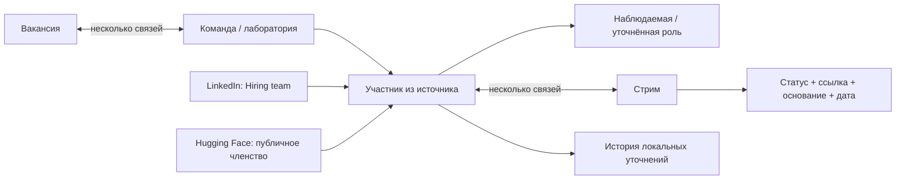

# Команды, контакты и исследовательские стримы

Срез 24.10.2026. Интерфейс: **Вакансии → выбранная вакансия → Команда и контакты**. Это общая сущность сервиса; LinkedIn и Hugging Face — источники, а не владельцы модели. Адаптер Сетки пока не реализован.

## Реализация

- [vacancy_team.py](../../src/vacancy_team.py): `/archive/vacancy-team`; команды, связи с вакансиями, участники, история уточнений. Таблицы `network_teams`, `network_vacancy_teams`, `network_members`, `network_events` в общей локальной SQLite.
- [vacancy-team.js](../../archive-web/vacancy-team.js): вкладка основной карточки вакансии, сбор из источников, фильтр стримов, роли и локальная разметка.
- `linkedin.team.read`: чтение только участников, показанных около конкретной вакансии; идентификаторы вакансии и команды связаны с командой очереди.
- Hugging Face: публичный `/api/organizations/{organization}/members`, фиксированный HTTPS-host, без cookies/токенов локального сервиса и без переходов по redirect.

По умолчанию доступны Pre-training, Post-training, Optimization, Distillation, Super-resolution, VAE / KVAE, Captioning Pipeline, Pre-training Data, Post-training Data, Metrics & Evaluation (Benchmarking), Harness. Один человек может иметь несколько назначений со ссылкой, основанием, датой и статусом `confirmed` / `hypothesis`.

## Границы достоверности

Публичное членство в организации не доказывает роль, принадлежность конкретному стриму, работу над конкретной вакансией или полноту списка команды. Роль, не указанная источником, остаётся неизвестной. Стримы не назначаются автоматически по имени, членству или одному коммиту. Подтверждение — явное локальное уточнение со ссылкой и основанием.

Участники разных платформ имеют разные source IDs. Автоматического слияния людей по имени нет. `observed_role` сохраняет исходную роль, `role` — локальное уточнение. Повторное чтение источника сохраняет локальную разметку; изменение требует актуальной revision и записывает before/after в историю.

Живая проверка 24.10: для команды Kandinsky Lab, связанной с сохранённой `hh_138714095`, импортированы 38 публичных участников Hugging Face. Все остались без автоматически назначенных ролей и стримов. Доступность участников LinkedIn зависит от показанного Hiring team; полный штат не обещается.

Чаты, контакты и история команды остаются локальными; они не входят в публичную проекцию портфолио, GitHub Actions или обычный экспорт сущностей CV/JD. Автоматических сообщений, приглашений и откликов этот режим не отправляет.
