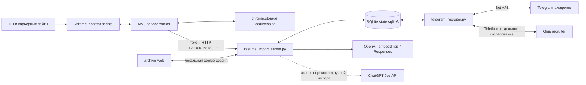

# Архив архитектурного аудита 19–20.10.2026

> Сверка 22.10.2026. Архивный документ / исходное предложение. Исторические даты, версии, проверки и ограничения ниже сохранены; они не заменяют [текущее состояние](../architecture/current-state.md). Текст исходного ТЗ не является командой запуска всех фаз.

> **Обновление UX и Skills scopes, 20.10.2026:** [Today, вакансии, рейтинг, отклики и три основы плана навыков](../integration/workspace-ux.md). 373 Python / 323 JS; Career Path от evidence к целевому профилю, без новых платных вызовов.

> **Обновление Skills Intelligence, 20.10.2026:** [реализованный модуль, контракт, использование и ограничения качества](../architecture/skills-intelligence.md). 33 навыка / 6 версионируемых треков, общие Web/Telegram рекомендации по top-K, evidence feedback и история; 369 Python / 320 JS. Live Web: 50 вакансий, API 0. Независимая массовая разметка и аудит GitHub остаются дальнейшей работой. Эта фаза реализована по отдельному явному запросу пользователя; исторический baseline ниже сохранён.

> **Актуальный срез 20.10.2026:** [Отчёт для следующего планирования — 20.10.2026](../handoff/2026-10-20-agent-planning-brief.md). API 13 / Extension 0.11.18; 350 Python / 318 JS. Добавлено opt-in бесплатное поднятие выбранных HH-CV через общую очередь (успешный live receipt пока не подтверждён). Добавлены durable Luna top-50/offline import, расширенная таксономия, линейный автомасштаб, fullscreen/PNG, ручные source-specific отметки отклика и web diagnostics. Неклассифицированных 1124 → 150 по правилам, без доказанной accuracy-метрики. Общая живая Telegram E2E готовность по-прежнему не подтверждена. Исторические абзацы ниже читать с этим уточнением.

> Обновление аналитики и Telegram 19.10.2026: [Sankey, фокус, исправление Apple-тегов, единый топ-10 и подробный разбор](../integration/career-analytics-telegram.md). Политика топ-10 и пометки ⭐ в этом отчёте заменяет прежние правила короткой подборки.

> Обновление 19.10.2026, API 13 / Extension 0.11.16: [сквозная интеграция Telegram, исправления, 305 Python / 292 JS и оставшиеся ограничения](../integration/telegram-career-e2e.md). Исторические записи ниже описывают состояние на момент аудита, не отменяют уточнений в этом отчёте. Полный live E2E всех компаний не объявлен готовым.

> Обновление после аудита, 19.10.2026: общий `CareerApplication`, backend scheduler с SQLite lease, bounded conversational router, versioned task control и MCP stdio реализованы. Фактические контракты, ограничения и запуск: [Общий application layer](../architecture/application-layer.md). Исторические findings ниже описывают baseline аудита; G22/G24/G25 закрыты в указанном объёме, G27 — для поддержанных стадий. G23/G26 остаются открыты.

Дата аудита: 19 октября 2026, Europe/Moscow. Область: `tools/cv_matcher`, связанные `cv-api`, интерфейс портфолио и workflows корневого репозитория. Это описание реализации, а не целевой спецификации. Следующие документы: [целевая архитектура](../architecture/target-state.md), [разрывы](../architecture/gap-analysis.md), [план](../roadmap.md).

## 1. Вывод и границы подтверждения

Проект уже представляет собой локальную систему сопровождения поиска работы: Chrome MV3, Python/FastAPI, SQLite, веб-интерфейс, управляющий Telegram Bot API бот и Telethon для Giga. Есть поиск по расписанию, семантический рейтинг, доказательные разборы, письма, анкеты, CRM и согласование конкретных действий. Это существенно больше парсера. Однако универсальный автономный отклик на сайтах компаний не реализован.

Основной пользовательский конвейер работает через `resume_import_server.py` на `127.0.0.1:8788`. Отдельно существует более ранний путь сбора через `server.py:8787`, ChromaDB и публичные JSON. Их нельзя считать единым автоматически синхронизируемым хранилищем.

Метод аудита: статическое чтение кода, маршрутов, SQL, конфигурации и тестов; локальные тесты с подменой браузера/моделей; чтение метаданных текущих очередей и системного журнала сна. API моделей, отклики работодателям и новые облачные ресурсы для аудита не запускались. Наличие кода, прохождение теста и успешная живая интеграция — разные уровни подтверждения. Развёртывание Vercel/GitHub Actions и все сайты в этом аудите не проверялись.

В начале проверки исходники расширения имели версию **0.11.11**, локальный HTTP-протокол — **10**. Во время аудита по отдельному сообщению пользователя подготовлена **0.11.12**: пакетный расчёт до 2000 вакансий и название «Подготовить отклик». Это не означает, что работающий Chrome уже загрузил новую версию.

## 2. Компоненты и потоки данных



Модели вызываются фиксированными функциями Python; свободного LLM-агента с произвольным набором browser tools здесь нет. Решения о выполнении действий задаются состояниями, проверками версий и явными разрешениями. Очередь передаёт команды расширению; браузер остаётся исполнителем DOM-действий в пользовательской сессии.

| Граница | Реальная реализация | Ответственность |
|---|---|---|
| Локальный API | [create_app / main](../../resume_import_server.py) | Авторизация, imports, rank, cover; установка archive/workflow routes; scheduler чтения HH |
| Архив | [ArchiveStore](../../src/archive_store.py), [AnalysisStore](../../src/analysis_store.py) | Снимки, версии, membership, векторы, рейтинги, разборы |
| Отклики | [ApplicationStore](../../src/application_store.py), [WorkflowMixin](../../src/application_workflow.py) | Контекст, команды, согласования, фактические наблюдения HH |
| Telegram | [OperatorBot / UserTransport / run](../../telegram_recruiter.py), [WorkflowBot](../../src/workflow_bot.py), [RecruiterController](../../src/recruiter_controller.py) | Личный пульт, расписание, уведомления; отдельный диалог Telethon с Giga |
| Веб | [index.html](../../archive-web/index.html), [archive.js](../../archive-web/archive.js), [workflow.js](../../archive-web/workflow.js), [journey.js](../../archive-web/journey.js) | Сегодня, вакансии, рейтинг по CV, резюме, отклики, история, настройки, руководство |
| Компании | [company_catalog.py](../../src/company_catalog.py), [company-settings.js](../../archive-web/company-settings.js) | Редактируемые tiers, aliases, job boards и пользовательские CSS-селекторы |
| Планирование | [PlanningMixin](../../src/crm_planning.py), [GoogleCalendar](../../src/google_calendar_sync.py), [calendar_routes.py](../../src/calendar_routes.py) | Этап, следующий шаг, встречи, ICS, явная синхронизация личного календаря |

## 3. Chrome Extension

[manifest.json](../../hh-research-extension/manifest.json): Manifest V3, `background.service_worker = background.js`, popup и options page. Постоянных content scripts в manifest нет. Код внедряется через `chrome.scripting.executeScript`; bridge локального сайта отдельно регистрируется через `registerContentScripts` в [hh-connection.js](../../hh-research-extension/hh-connection.js).

Обязательные разрешения: `activeTab`, `scripting`, `storage`, `alarms`. Optional hosts: loopback, Google Docs/googleusercontent, HH, Avito, обе площадки Ozon, Yandex RU/COM, Sber, T-Bank с/без www. Выдача разрешения, открытая вкладка, успешный вход, heartbeat исполнителя и завершённая задача проверяются отдельно. Обход login/CAPTCHA не реализован.

[background.js](../../hh-research-extension/background.js) явно загружает общие cores, навигацию и workers через `importScripts`. Общий `activeJobs` — блокировка в памяти одного service worker, не распределённый lock. Долговечность обеспечивают сохранённые команды и receipts, а не сама переменная.

| Функция | Модули |
|---|---|
| HH SERP/detail | [content.js](../../hh-research-extension/content.js), [hh-crawl-core.js](../../hh-research-extension/hh-crawl-core.js), [hh-crawl.js](../../hh-research-extension/hh-crawl.js) |
| Компании | [board-core.js](../../hh-research-extension/board-core.js), [board-content.js](../../hh-research-extension/board-content.js), [board-crawl.js](../../hh-research-extension/board-crawl.js) |
| Навигация | [navigate](../../hh-research-extension/browser-navigation.js): bounded ожидание URL и читаемого DOM, а не только окончания рекламных запросов |
| CV | [resume-worker.js](../../hh-research-extension/resume-worker.js), [resume-content.js](../../hh-research-extension/resume-content.js), [resume-intake-worker.js](../../hh-research-extension/resume-intake-worker.js) |
| Общая очередь | [hh-workflow.js](../../hh-research-extension/hh-workflow.js), [discovery-worker.js](../../hh-research-extension/discovery-worker.js), [career-workflow.js](../../hh-research-extension/career-workflow.js) |
| HH статусы/чаты | [hh-sync-core.js](../../hh-research-extension/hh-sync-core.js), [hh-sync-content.js](../../hh-research-extension/hh-sync-content.js) |
| HH форма/отправка | [hh-apply-core.js](../../hh-research-extension/hh-apply-core.js), [hh-apply-content.js](../../hh-research-extension/hh-apply-content.js) |
| Компании: анкеты | [career-form-core.js](../../hh-research-extension/career-form-core.js), [career-form-content.js](../../hh-research-extension/career-form-content.js) |
| Встроенные панели | [hh-badges-background.js](../../hh-research-extension/hh-badges-background.js), [hh-badges-content.js](../../hh-research-extension/hh-badges-content.js), [hh-inline-ui.js](../../hh-research-extension/hh-inline-ui.js) |
| Синхронизация | [archive-sync.js](../../hh-research-extension/archive-sync.js), [archive-sync-core.js](../../hh-research-extension/archive-sync-core.js) |
| Диагностика | [diagnostics-worker.js](../../hh-research-extension/diagnostics-worker.js), [diagnostics-core.js](../../hh-research-extension/diagnostics-core.js) |

`chrome.storage.local` хранит `vacancies`, `resume_bundle`, каталог, цели, `last_ranking`, crawl states, archive outbox и receipts. `storage.session` — привязки вкладок/форм, worker context и pairing token. При отдельном выборе «запомнить» токен записывается в local. [LocalResumeService](../../hh-research-extension/local-service.js) обращается к фиксированному loopback и allowlist путей; ключ OpenAI туда не передаётся.

Сообщения `chrome.runtime.onMessage` проверяют `sender.id`; опасные обработчики дополнительно проверяют extension sender, URL, vacancy ID, исходную вкладку, fingerprint и разрешение. Страница не получает pairing token. [workspace-bridge.js](../../hh-research-extension/workspace-bridge.js) принимает только узкую команду `open_setup` с того же origin. Контракты сообщений распределены по workers, единой типизированной схемы пока нет.

## 4. Источники, извлечение и обход

Пять адаптеров компаний описаны в [adapters/](../../hh-research-extension/adapters): `avito.json`, `ozon.json`, `yandex.json`, `sber.json`, `tbank.json`. Общие правила — [runtime.js](../../hh-research-extension/adapters/runtime.js); [build-adapters.mjs](../../hh-research-extension/scripts/build-adapters.mjs) генерирует [board-adapters.js](../../hh-research-extension/board-adapters.js). HH имеет отдельный адаптер. Наличие компании в tiers не означает наличие адаптера.

| Источник | Подтверждённая стратегия кода | Ограничение |
|---|---|---|
| HH | Семантические `data-qa`, ссылки SERP, отдельное чтение JD, next page с сохранением CV/фильтров | Только доступная пользовательской сессии выдача; лимиты/partial |
| Avito | CSS `.vacancies-detail__description`, карточки/ссылки | Полное покрытие динамической выдачи не гарантируется |
| Ozon.Tech / career.ozon.ru | Разные layouts двух hosts, общая логика identity | Это два варианта сайта, а не один универсальный selector |
| Yandex | JSON/DOM-селекторы адаптера, ссылки на jobs | Чтение не равно успешному заполнению/отправке |
| Sber | Собственный URL/identity, общие JSON-LD и DOM fallback | Отдельной завершённой автоматической отправки нет |
| T-Bank | Named sections «Описание/Обязанности/Требования/Мы предлагаем», исключение анкеты; фильтры IT + ML | Нестандартный DOM; динамическая выдача может быть partial |
| Samokat.Tech / MTS MWS | В реестре пяти company adapters отсутствуют | Настройки tiers/старый Python MTS scraper не заменяют Chrome adapter |

`board-content.js` использует DOM selector → `JobPosting` JSON-LD → тематические секции → ссылки списка. Возвращает `full`, `snippet` или `needs_review`, источник и метод. Пользовательские селекторы требуют проверки; внешние iframe требуют открытия источника. Само наличие поля `full` — правило извлечения, не измеренная гарантия полноты.

HH crawl: последовательный bounded обход, по умолчанию до 20 страниц / 200 новых JD / 4 минут, остановка и прогресс. Company crawl также ограничен временем/страницами/JD; next links проверяются на источник и фильтры, «Показать ещё»/infinite scroll часто дают partial. [ResearchSearch.detailFresh / mergeVacancies](../../hh-research-extension/core.js): полное описание переиспользуется **24 часа**, если нет явного изменения/закрытия; сниппет не заменяет JD. `listing_snapshot` выявляет изменения известных полей, но не невидимые изменения полного текста. Force позволяет перечитать JD.

Полям кэша `description_fetched_at`, `description_dirty`, `listing_snapshot`, `listing_changed_at` сейчас нет соответствия в allowlist архивной синхронизации. Они остаются локальной browser metadata: восстановление из SQLite не является точным восстановлением политики свежести.

## 5. Хранилища и идентичность

Главная SQLite: `.cache/applications/state.sqlite3`. [ArchiveStore](../../src/archive_store.py) и [ApplicationStore](../../src/application_store.py) используют один файл; archive включает WAL. Изменения schema выполняются `CREATE IF NOT EXISTS`/проверками колонок, без единой нумерованной системы миграций. Директория защищается `0700`, файл — `0600`; это файловые права, не шифрование БД.

| Семейство таблиц | Данные и владельцы |
|---|---|
| `entities`, `versions`, `receipts`, `scans`, `membership`, `events`, `profiles` | Текущая сущность + неизменяемые версии, idempotent sync, присутствие в конкретной выдаче; ArchiveStore |
| `embedding_vectors`, `document_embeddings`, `ranking_runs`, `archive_meta` | Float32 BLOB, namespace/model/hash/chunk bindings, JSON рейтинга; AnalysisStore |
| `skill_analyses`, `skill_analysis_sources`, `skill_analysis_failures`, `external_analysis_requests` | Разборы с исходными версиями, невалидные ответы, экспорт без API |
| `applications`, `turns`, `settings`, `application_channels` | Контекст отклика, вопросы/ответы, настройки и связь HH↔Telegram одного кейса |
| `application_workflow`, `application_drafts`, `application_discussion`, `application_approvals`, `application_events`, `browser_commands` | Редакции письма, разрешения, история и очередь Chrome |
| `hh_observations`, `hh_threads`, `hh_messages` | Наблюдения статусов, привязки чатов, сообщения и источники |
| `workflow_delivery`, `discovery_runs` | Outbox уведомлений, состояние поиска по расписанию |
| `candidate_profile*`, `candidate_facts`, `resume_supplements`, `application_form_versions`, `application_field_*` | Версионируемые данные профиля, пользовательские факты, анкеты и ответы |
| `application_crm`, `application_appointments`, `calendar_links`, `giga_invites`, `giga_starts`, `resume_review*` | Этапы и метастатусы, встречи, привязки календаря, Giga и анализ CV |

Vacancy envelope: `id`, `title`, `company`, `link`, `description`, `description_quality`, source timestamps, provenance/adapter, `archived`, `availability_checked_at`, `recommended_for`. CV bundle v2: `primary_id`, `resumes[]`; CV содержит `source_type`, `sections`, `quality`, `content_hash` и даты проверки/подтверждения. Файлы имеют `file_<sha256>`; HH CV — ID из URL. Правила в [resume_source.py](../../src/resume_source.py), импорт/редакция в [resume_files.py](../../src/resume_files.py), [resume_intake.py](../../src/resume_intake.py).

Идентичность вакансий реализована в [board-core.js](../../hh-research-extension/board-core.js) и [board_import.identity](../../src/board_import.py): source IDs `hh_`, `avito_`, `ozon_`, `yandex_`, `sber_`, `tbank_`; generic HTTPS URL получает `board_<hash>`. Это дедупликация внутри источника. `ApplicationStore.create` использует `channel + vacancy_id` как unique dedupe. `application_channels` связывает коммуникационные каналы одного отклика, но не похожие вакансии HH и job board. Семантических межисточниковых групп в локальной CRM нет. `difflib` в архиве применяется для diff версий, не entity resolution.

Положительное закрытие вакансии отделено от исчезновения из выдачи: membership absence не равно `closed`; неизвестный статус HH не равен отказу. Эти инварианты уже есть и должны сохраниться.

## 6. Embeddings и рейтинг

Текущий путь: [rank_vacancies / OpenAIBackend](../../src/extension_ranking.py) → [CachedEmbeddings](../../src/resume_source.py) → [AnalysisStore](../../src/analysis_store.py). Модели в коде: `text-embedding-3-small` (1536) и `text-embedding-3-large` (3072). OpenAI вызывается из Python, batch до 64 chunks, `max_retries=0`; ключ из server environment. Chunking по ~950 символов, нормализация и удаление контактов. Namespace включает класс backend, endpoint, model, dimensions, version и hash текста. SQLite хранит новые векторы; legacy JSON cache можно индексировать без нового API.

Для каждого JD chunk выбирается максимальная cosine близость к chunks выбранного CV. `cv_similarity` — среднее двух сильнейших JD chunks; при цели итог `0.8 × CV + 0.2 × max(goal similarity)`. `top` содержит 10, `all` — все рассчитанные строки, с близкими фрагментами. Это эвристика семантической близости, не вероятность приглашения и не доказательство всех требований. Нет калиброванного learning-to-rank, cross-encoder reranker или проверки relevance по размеченной выборке.

Кэш итогов привязан к CV hash, JD hash, цели и embedding-модели. В режиме `allow_api=False` отсутствующий вектор вызывает явную остановку/пропуск в discovery; автоматической генерации «бесплатных» embeddings нет. Ручной запрос в ChatGPT — другой режим.

Предел `/rank` — **200 вакансий в одном запросе**, до 4000 chunks. До исправления 0.11.12 UI также молча ограничивал весь расчёт 200. [ranking-batch.js](../../hh-research-extension/ranking-batch.js) теперь разбивает выборку до 2000 на запросы по 200, сортирует общий результат, суммирует usage и сохраняет partial при ошибке. [ranking.js](../../hh-research-extension/ranking.js) различает максимум расчёта и число показанных строк. Архив принимает объединённый рейтинг до 2000 / 8 MiB. Веб-маршрут `/archive/rank` пока сохраняет свой предел выборки 200 и требует сузить фильтр; это оставшийся разрыв между интерфейсами.

## 7. Luna и контракты API

Отдельного микросервиса «Luna» нет: это имя модельного backend. [recruiter_answers.MODELS](../../src/recruiter_answers.py): `luna → gpt-6-luna`, `terra → gpt-5.6-terra`, `sol → gpt-6.1-sol`. Это фактические строки конфигурации кода, а не внешняя проверка доступности моделей. Skill analysis фиксирует Luna; cover по умолчанию может использовать `COVER_LETTER_MODEL`/`gpt-4.1-mini` или выбранный alias. Основные вызовы Responses используют JSON Schema и `store=False`.

| Реальный маршрут | Вход → выход / реализация |
|---|---|
| `POST /extract` | filename + base64 → извлечённый профессиональный текст; [resume_import_server.py](../../resume_import_server.py) |
| `POST /rank` | выбранный CV bundle, JD[], goal, model, allow_api → scores, all/top, hashes, usage; [extension_ranking.py](../../src/extension_ranking.py) |
| `POST /cover-letter` | CV + одна полная JD, comments, sentence_count, model → редактируемый текст, matches/цитаты, hashes, usage; [cover_letter.py](../../src/cover_letter.py) |
| `POST /answer-draft` | application_id, question, model, comments → answer, needs_user, missing, evidence; [recruiter_answers.py](../../src/recruiter_answers.py) |
| `POST /archive/skill-analysis` | resume_id, vacancy_id, goal → requirements, goal_alignment, recommendation, questions, limitations, metrics; [skill_analysis.py](../../src/skill_analysis.py) |
| `POST /archive/skill-external` | export/import с export_id → промпт либо проверенный JSON-разбор без API; [external_analysis.py](../../src/external_analysis.py) |
| `POST /archive/resume-review` | op prepare/prompt/generate/import/save_supplement → контекст CV, до 10 ranked JD, анализ/проекты/уточнения; [resume_review.py](../../src/resume_review.py) |
| `POST /archive/hh-inline` | CV/JD IDs + action analysis/cover/answer/export/import/read/save → общий результат виджета; [hh_inline.py](../../src/hh_inline.py) |
| `POST /archive/workflow` | `op` + context/revision/command fields → состояние, анкета, очередь, intent/approval/result; [workflow_routes.py](../../src/workflow_routes.py) |

Схемы модели содержат R/J/U/H/G references. Skill validator проверяет существование ID, дословные JD quotes, допустимые статусы и ограничения учебного опыта; вычисляет coverage отдельно. Неуспешный разбор сохраняется для локальной повторной проверки без нового платного запроса. Это не полноценная проверка смыслового entailment. Cover writer допускает **до двух запросов** с одним исправлением; политика повторов отличается от skill/resume review. Единого budget/attempt ledger для всех LLM paths нет.

API в основном принимает JSON dict с ручной валидацией. В `create_app` есть in-process locks, но не общая межпроцессная очередь модельных задач. Подробные HTTP routes устанавливают [archive_routes.py](../../src/archive_routes.py), [workflow_routes.py](../../src/workflow_routes.py), [calendar_routes.py](../../src/calendar_routes.py). Модельные схемы и transport API схемы — не одно и то же.

Без API уже доступны экспорт CV/JD/цели/пожеланий/вопросов, импорт разбора, ручные письма/ответы, анализ CV, [отбор коротких описаний](../../src/vacancy_selection.py). Экспорт всех вакансий пока представляет собой один большой prompt; отсутствует полноценный пакетный selection/import workflow для всего архива.

## 8. Отклик, согласование и расписание

HH: создать application → draft/revision → `prepare` → чтение формы → intent по конкретной форме/CV/JD/тексту → approve → queue `execute` → одноразовый claim → DOM submit → проверка подтверждения. Неопределённый результат становится `uncertain`; слепой повтор запрещён. Receipts в Chrome переживают потерю HTTP ответа, их отправка не повторяет browser action. См. [WorkflowMixin](../../src/application_workflow.py), [hh-workflow.js](../../hh-research-extension/hh-workflow.js).

Company forms: capture → сохранение вопросов и fingerprint → предложенные значения профиля/ответов → approve → `career_fill` → перенос и проверка. Поддерживаются текстовые поля и специальный T-Bank city control с выбором реального option; файлы, согласия, неизвестные controls и **финальная отправка на сайтах компаний остаются ручными**. [CareerFieldsMixin](../../src/career_application_fields.py) и [career-workflow.js](../../hh-research-extension/career-workflow.js) не являются универсальным submit adapter.

Giga: приглашение из HH → связь с кейсом → отдельный подтверждённый `/start` → чтение вопроса через Telethon → draft API/без API → проверка/редакция владельцем → конкретная отправка. Активен один Telegram interview context. CAPTCHA, WebApp, контакты/вложения требуют участия владельца. Стадии CRM и метастатусы `waiting_reply`, `waiting_invitation`, `scheduled` отделены от внешних HH states.

Планировщики:

- [hh_auto_sync.tick/run](../../src/hh_auto_sync.py): цикл asyncio в lifespan HTTP-сервиса, tick каждые 30 с, чтение HH по умолчанию раз в 300 с, свежая capability исполнителя и backoff.
- Chrome alarms: HH workflow, collection, career/resume workers и синхронизация; задачи хранятся в `browser_commands`, read-only stale commands могут возвращаться в queued. `execute`/`career_fill` не повторяются как обычное чтение.
- [WorkflowBot.tick](../../src/workflow_bot.py): 10:00/19:00 Europe/Moscow по умолчанию; догоняет последний слот в пределах четырёх часов. Запускает [discovery.start/advance](../../src/discovery.py): очередь источников → CV → JD → cached/разрешённый API rank → подборка. До 6 источников, 1–5 страниц/1–100 JD на источник, до 600 IDs на run; ranking batches до 200.
- Доставка: `application_events` → anti-join отсутствующих `event:<id>` outbox записей → [DeliveryMixin](../../src/delivery_store.py) → Telegram. Есть lease, states pending/sending/sent/uncertain, явная сверка неизвестного результата. Это не гарантия exactly-once внешнего транспорта.

**Ноутбук должен быть доступен.** Бот и SQLite локальны; закрытие крышки не переносит их в облако. Системные краткие DarkWake могут позволить отправку уведомления, но не гарантируют выполнение Chrome crawl. В метаданных 19.10: DarkWake в 10:29:41 и 10:40:29; доставки в 10:29:46 и 10:40:35. Discovery закончился `failed` с лимитом времени; сообщения о ходе/проблеме не означают новую подборку. Последняя прочитанная sync-команда также была `failed`: конфликт уже привязанного Giga invite. Это текущие диагностические факты, не постоянные свойства каждого запуска.

Telegram уже является развитым пультом, но ещё не полноценным natural-language Career Agent interface. `WorkflowBot.update` маршрутизирует команды/callbacks и directed text при waiting context. `/pause` в `RecruiterController` — пауза активного Giga-диалога, `/cancel` — отмена ввода; универсального управления фоновой operation так нет. Selection и продвижение discovery находятся в `WorkflowBot`, а `workflow.tick` вызывается из Telegram loop. Поэтому бизнес-исполнение ещё частично зависит от процесса Telegram. HH/company approvals имеют TTL/versions, Giga draft token/current-question checks не имеют той же общей TTL approval модели. Исследование и целевой рефакторинг: [ADR 0005](../architecture/adr/0005-telegram-primary-control.md).

## 9. Аутентификация и локальная безопасность

Loopback API использует `X-Resume-Import-Token`, сравнение hmac; token-файл `0600`. CORS — regex extension origins, а не индивидуальная идентичность доверенного extension. Веб получает одноразовый код на 60 с и HttpOnly/SameSite=Strict cookie на 12 часов, хранимую в памяти API. State-changing cookie routes проверяют origin; browser execution ops требуют token. Перезапуск API сбрасывает cookie-сессии.

Сессией HH владеет Chrome; cookie jar не копируется в API. Telethon использует `.cache/telegram/recruiter-user.session`, Bot API — env token, callbacks проверяют owner/private chat. Google OAuth/PKCE credentials хранятся в `.cache/calendar/oauth.json`, отдельно от SQLite/backup. Календарный `connected` означает наличие refresh token, не свежую успешную RPC-проверку. Профиль автозаполнения хранится отдельно от текста, отправляемого модели.

Импорт чужого HH CV по URL не требует членства в собственном каталоге, но требует фактического доступа в текущем Chrome; чужая сессия из одной ссылки не возникает.

## 10. Старый и публичный контуры

[server.py](../../server.py) — FastAPI `127.0.0.1:8787`, in-memory `JOBS`, daemon threads, SSE `/scrape/stream/{job_id}`, `/scrape/start`, `/scrape/sources`, `/scrape/jobs`; используется [src/scrape.ts](../../../../src/scrape.ts). Отдельного pairing/auth middleware здесь нет; CORS не заменяет аутентификацию.

[SCRAPER_REGISTRY](../../src/scrapers/__init__.py) содержит 20 Python scraper classes: HH, Yandex, Tinkoff, Avito, Ozon, Sber, VK, X5, Wildberries, MTS, Alfa, RemoteOK, WWR, HN, LinkedIn, Indeed, WTTJ, Wellfound, Google, Meta. Это не 20 адаптеров Chrome и не 20 адаптеров отклика. Sber есть в registry, но отсутствует в `SOURCE_GROUPS['ru']` и производном `all`.

[BaseScraper](../../src/scrapers/_base.py) использует Playwright и опциональный `storage_state_path`. [collection_contract.py](../../src/collection_contract.py) уже умеет нормализовать поддержанные company rows, записывать их в общий архив и запускать тот же JS board adapter на Playwright page. Это существующий шов для объединения; не все старые коллекции обязаны идти через него.

[RAGDatabase](../../src/rag_db.py) — PersistentClient ChromaDB, collection `vacancies`, cosine; embeddings через Ollama, прямой OpenAI либо Vercel `CVApiEmbeddings`. [cv_matcher.py](../../cv_matcher.py) и scripts используют отдельную batch/scoring/export логику. [cv-api/api/](../../../../cv-api/api) содержит существующие serverless handlers (embeddings, ATS, coverletter и др.), не локальный Luna API. `embeddings.js` проверяет Bearer только при заданном `API_SECRET`; реальные deployment secrets не проверялись.

[daily-scrape.yml](../../../../.github/workflows/daily-scrape.yml) объявляет GitHub Actions daily 07:00 UTC, Playwright scrape, tree/Chroma/cluster map и публикацию JSON. [rag_updater.yml](../../../../.github/workflows/rag_updater.yml) — manual-only. Связи «облачный JSON автоматически попал в личную SQLite/Telegram» в проверенном локальном workflow нет. Наличие расписания в YAML не доказывает успешность его последних запусков.

## 11. Сквозная трасса и связность компонентов

| Переход | Реальные функции и транспорт | Что сохраняется / что не связано автоматически |
|---|---|---|
| Цель → поиск | `WorkflowBot.begin_digest` или workflow `discovery_start` → `discovery.start/queue_source` | `profiles`, `settings`, `discovery_runs`, `browser_commands(kind=discover)` |
| Команда → источник | `collectionPulse` → `next_command(kinds=['discover','collect'])` → `wfCollect` → `runHHCrawl/runBoardCrawl` | Chrome `vacancies`/crawl progress; URL, scope и source IDs; настоящий browser executor нужен |
| Прочитанное → архив | `ArchiveSyncCore.record` → `/archive/sync` → `ArchiveStore.sync/_entity` | `entities/versions/receipts`; перед result discovery snapshots должны попасть в SQLite |
| Архив → семантика | `discovery.advance` или `/rank` → `rank_vacancies` → `CachedEmbeddings` | `embedding_vectors`, `document_embeddings`, `ranking_runs`; текущий продукт реально использует векторы SQLite |
| Рейтинг → рекомендация | `WorkflowBot.finish_digest/candidates` → `enqueue/flush_deliveries` | `workflow_delivery`, recommendation settings; activity/format/CV filters могут исключить ranked row |
| Пара CV/JD → Luna | `/archive/skill-analysis` → `skill_analysis.context/analyze/validate/metrics` | `skill_analyses`, `skill_analysis_sources`, versions, goal; invalid response идёт в failures |
| Выбор → CRM | workflow `make` → `ApplicationStore.create` → `workflow` | `applications`, `application_workflow`, channels; idempotent `channel:source_id` |
| Текст → редактируемая версия | `/cover-letter` или `hh_inline.run` / `discuss`; workflow `draft` → `save_letter` | Модельный cache и отдельная `application_drafts`/revision; получение текста модели само по себе не означает его утверждение |
| CRM → подготовка формы | workflow `prepare` → `queue_command('prepare')`; `hhWorkflowPulse/wfPrepare/wfApply` → `prepared` | `browser_commands`, form snapshot и fingerprint; состояние `needs_approval` |
| Предпросмотр → человеческое разрешение | `intent` → владелец в вебе/Telegram → `approve` | Exact-content approval и только затем очередь `execute`; постановка prepare **не разрешает** отправку |
| Разрешение → сайт | `next_command` → `wfExecute` → `claim_approval` → `HHApply` → `finish_command` | Single-use claim, receipt, `submitted` только с evidence либо `uncertain`; не универсальный company submit |
| HH → CRM → уведомление | `wfCurrentSync` → `/archive/workflow op=observe` → `hh_sync` → `application_events` → `enqueue_event_notifications` → DeliveryMixin | `hh_observations/messages`, application status/CRM, outbox/receipt; unknown/absence не становятся отказом |

Для компаний вместо HH prepare/execute сегодня используется capture формы → `career_form` → `career_fill_intent/approve/claim/result`; последняя отправка ручная. Giga ветвится из HH invitation через `start_screening`, затем сохраняет `turns` и общий case. Это переиспользуемый human-in-the-loop механизм, а не новая система согласований с нуля.

**Связность неполная:** поиск, ranking и analysis могут быть восстановлены по source IDs, версиям и goal; CRM хранит своё frozen context. Но `make` не принимает `analysis_key`/`discovery_run_id`; нет общей обязательной цепочки provenance от рекомендации до application. Наличие анализа Luna не является обязательной стадией создания кейса. Сохранённый skill report не следует путать с утверждённым письмом или разрешением. Для будущего агента нужны явные ссылки между существующими records, а не новая CRM.

Дополнительный read-only срез во время аудита: личная SQLite содержит 6 CV / 1969 вакансий, 2307 small embeddings (1536), 2399 bindings и 21 ranking run. Chroma содержит `vacancies` размерности 1536 / 2453 embedding rows. Это два набора представлений, не доказательство дубликата каждого вектора. [BaseScraper.fetch_jobs](../../src/scrapers/_base.py) уже вызывает `normalize_browser_rows/archive_browser_rows` для поддержанных company rows: мост частично реализован. У старого pipeline остаются собственные индекс/алгоритмы/JSON; личный бот Chroma напрямую не читает.

MCP implementation/tool registration в исследованных `tools/cv_matcher`, `cv-api`, корневых `src`/package manifests не найдено. Проект интерфейса и решения: [ADR 0001](../architecture/adr/0001-reuse-existing-workflow.md), [ADR 0002](../architecture/adr/0002-sqlite-and-chroma.md), [ADR 0003](../architecture/adr/0003-thin-mcp-and-human-approval.md), [ADR 0004](../architecture/adr/0004-local-availability.md). Предлагаемые tools не выдаются за существующие.

Изолированный [test_architecture_flow.py](../../src/tests/test_architecture_flow.py) проходит existing discovery → fake browser result → настоящий ranker с fake vectors → настоящий Luna validator с fake response → CRM routes → Chrome prepare queue/result → human approval preview → fake Telegram notification. Он останавливается до согласования/отправки. Протокол MCP и реальные внешние сервисы этим тестом не проверяются.

## 12. Проверки, метрики, наблюдаемость

Входной baseline: **276 Node tests и 262 unittest tests прошли** 19.10.2026. Команды из корня `tools/cv_matcher`:

```sh
node hh-research-extension/scripts/check.mjs
.venv/bin/python -m unittest discover -s src/tests -t .
```

Node checker проверяет актуальность generated adapter bundle, синтаксис и `*.test.mjs`. Python tests покрывают архив, permissions/routes, grounding, ranking cache, 105 notification events, retry/uncertain, Chrome contracts, анкеты, owner-only Telegram, HH auto sync, Giga и календарные transport doubles. [test_scrapers.py](../../src/tests/test_scrapers.py) и `src/tests/scrapers` также содержат отдельные live CLI checks; прохождение unittest discover не означает, что все эти сайты опрошены вживую. После исправления 0.11.12 прошли **283 Node / 264 Python**; новые проверки описаны в [roadmap](../roadmap.md).

Есть локальные логи, command/event history, failure payloads, token usage/cache hits, состояния отдельных исполнителей, adapters diagnostics, model verification scripts. Нет единой сквозной trace ID, агрегированного SLO dashboard, relevance-labelled gold set, Recall/NDCG оценки рейтинга и статистики time-to-application. Текущие workflows корневого репозитория не запускают эти Node/Python suites как обязательную CI-проверку. Некоторые README/docstrings отстали от реализации (например, «daily scheduling not implemented» и старые номера версии); они не использовались как доказательство отсутствия функции.
