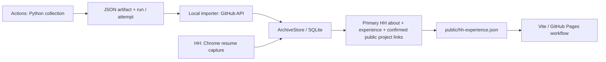

# GitHub collection + primary HH portfolio · 22.10.2026

> Сверка 22.10.2026. Действующий контракт. [Публичная проекция, восемь оформлений, static EN/RU и PWA](public-portfolio.md). Автопроверка импорта — час, публикации — 5 минут при работающем сервисе; это разные операции. SQLite не выгружается в GitHub.

Две независимые односторонние синхронизации используют существующий `ArchiveStore` и SQLite. Локальная база не выгружается в облако. GH CLI должен быть установлен и авторизован в аккаунте с доступом к репозиторию. Токены не передаются браузеру.

## Импорт вакансий

Веб: **Вакансии → GitHub Actions · импорт вакансий**. В «Сегодня» — в источниках и расписании. Кнопка запускает фоновую проверку; состояние опрашивается во время работы. Автопроверка раз в час включается отдельным флажком и работает при запущенном локальном сервисе. Пропущенные интервалы при сне не накапливаются.

- Фиксированный репозиторий, `daily-scrape.yml`, ветка `main`, только завершённые `schedule` / `workflow_dispatch` из исходного репозитория.
- Обрабатывается последний завершённый запуск из последних 30. Это bootstrap/актуальный снимок, не полное воспроизведение каждого исторического запуска. Повторная попытка того же run имеет собственный курсор.
- `vacancies-export-<attempt>` публикуется до построения дерева и коммита; перед загрузкой проверяются run ID, attempt, SHA, структура и размер. Частичный checkpoint текущего запуска сохраняется и при ошибке scraper-шага. Старый JSON из checkout не выдаётся за новый артефакт; импорт повторно проверяет run ID и attempt. Частичные ошибки источников показываются отдельно от общего conclusion workflow.
- Для старых запусков без артефактов — совместимый снимок JSON строго из `head_sha`. Он может предшествовать запуску; интерфейс явно показывает исторический режим и дату. Истёкший/отсутствующий артефакт не доказывает свежесть данных.
- Лимиты: 32 МБ на выгрузку, 20000 записей, 100000 символов описания, 100 записей на транзакцию. ZIP не распаковывается на диск.
- Канонические URL/ID через общий `board_import.identity`; tracking/fragment удаляются. Неверные записи отклоняются независимо. Краткие/сомнительные описания остаются `snippet` / `needs_review`. Длина сама по себе не доказывает полноту.
- Время повторного появления карточки не используется как дата извлечения описания. Более новый head и полное описание защищены от старых/неполных импортов; контакты очищаются штатным ArchiveStore.
- Каждая порция и её счётчики/позиция фиксируются одной SQLite-транзакцией. После ошибки повторная проверка продолжает сохранённую порцию; receipts, версии и события переиспользуются. Отсутствие вакансии в выгрузке не меняет её активность.
- Панель: последний импорт, данные от, run, прогресс, новые/изменённые/неизменённые/защищённые/отклонённые записи, дубли и ошибки источников. История последних 10 импортов — в `archive_meta`, ключ `github-collection-import`.

API: `GET /archive/github-import`; `POST` с `start` / `configure`. Доступ владельца и проверка Origin наследуются от локального сервиса. Параллельные процессы координируются возобновляемой SQLite lease. После аварии lease истекает через 10 минут.

Сбор не запускает модели. Шаги платной legacy-индексации и кластеризации полностью исключены из `daily-scrape.yml`; переменная `ENABLE_LEGACY_PAID_INDEX` больше не используется. Embeddings рассчитываются отдельно в локальном сервисе.

## Публикация основного HH-резюме

Веб: **Резюме → Портфолио · введение, опыт HH и GitHub**. Источник — `summary.primary_id`, не просто открытая карточка. Настройка автопубликации сохраняется в `archive_meta` под `portfolio-publication`; проверка каждые 5 минут при работающем сервисе. Первая публикация и режим автоматического обновления доступны отдельно.

Публикуются Title основного HH-CV, введение из `about` (либо проверенная локальная редакция RU/EN), компании, должности, периоды, длительность и описания секции `experience`. Образование публичной страницы пока берётся из контента портфолио; его перенос из HH и сертификаты — следующий шаг контракта. Используется тот же HH-парсер, что у локального просмотра. Нераспознанные роли/компании/даты останавливают публикацию; предыдущий сайт сохраняется. Контакты в описаниях редактируются, Candidate Facts/дополнения/трудовые документы не включаются. Смена timestamp при идентичном содержании не создаёт новый коммит.

Подтверждённые навыки берутся только из owner-confirmed практического опыта, проектов и исследований со ссылками GitHub. Обучение, планы и простые упоминания не засчитываются. Публичность репозитория проверяется через GitHub API; приватные репозитории исключаются, ошибка проверки останавливает публикацию. Это проверка доступности ссылки, а не независимая экспертиза уровня навыка. В UI доступен текст блока для ручного переноса в HH.

Публикация — единственный фиксированный путь `public/hh-experience.json` через Contents API с проверкой SHA. Она не отправляет остальные локальные изменения. Код синхронизации сам не меняет настройки видимости репозитория или Pages. Обновление JSON запускает существующую Vite-сборку. API `GET/POST /archive/portfolio-publication`, операции `preview`, `publish`, `configure`, `save_about`, `context`, `github_activity`, `visual_choices`, `visual_preview`, `visual_settings` защищены сессией владельца.

## Публичный сайт

По умолчанию минималистичная страница; полный CV и инструменты доступны с `?layout=full`. Один набор HH-опыта используется во всех вариантах подачи. Focus подсвечивает реальные упоминания направления, не меняет факты и не подтверждает навыки. Перевода автоматически нет: на другом языке показан статус «Ожидается перевод» и раскрываемый оригинал.

Оформления: Minimal, `?style=macintosh` (Macintosh ’84), `?style=openai` (OpenAI-inspired). Переключение анимируется с учётом reduced motion. Общие даты и достижения сохраняются; альтернативные заголовки/манифест не добавляют новых фактов.

Pages должен использовать **GitHub Actions**, публикующий `dist`. Режим `main / root` отдаёт TypeScript-исходники и даёт пустую страницу. Публичность сайта и доступность исходного репозитория — отдельные настройки; публикация JSON их не меняет.

## Следующая интеграция: LinkedIn

Спецификация: [LinkedIn — профиль и сбор рекомендуемых вакансий](linkedin-adapters.md). План: адаптер расширения → отдельный версионированный источник того же архива, сопоставление с HH и просмотр отличий. Запись в LinkedIn должна использовать отдельную команду с предпросмотром полей; история синхронизации хранит источник, базовую версию и результат. Механизм редактирования LinkedIn пока не реализован; текущий поток HH → сайт не выдаётся за двустороннюю синхронизацию.

## Проверки

Изолированные тесты покрывают URL/качество/старые снимки, дедупликацию, пакетные checkpoints и восстановление, leases, сбои сети/JSON, привязку artifact к run/attempt, права/Origin; публикацию опыта и введения, удаление контактов, практические подтверждения и приватные ссылки, отказ при неверном HH-тексте, отсутствие повторной публикации при неизменном опыте. Frontend: escaping, статус перевода, Focus во всех направлениях и сохранение фактов между оформлениями.

### Дополнительные оформления

В «Оформлении» доступны Minimal, Macintosh ’84, OpenAI-inspired · Calm, Material 3 Expressive, Quiet Glass и Raw / Structural. Для прямой ссылки используются `?style=material`, `?style=glass`, `?style=raw`; стили работают и с `layout=full`. Отдельный Calm не добавлен: он объединён с OpenAI-inspired, чтобы не дублировать переключатели. Это веб-интерпретации визуальных принципов, а не официальные компоненты Google или нативный Liquid Glass. Прозрачность ограничена навигацией, текст остаётся на плотных поверхностях; учитываются reduced-motion, reduced-transparency и increased-contrast.

Полная версия сохраняет весь текст опыта, но использует тот же лёгкий макет: печать/PDF, Markdown, раскрываемый стек, один Focus. Старые публичные панели AI Tools, Technical/Product и графические представления стека из основной страницы убраны.

## Введение, траектория и исследования GitHub

В предпросмотре портфолио — редактор введения без заголовка «Обо мне». По умолчанию текст поступает из HH. Можно сохранить проверенные RU/EN-редакции в локальной базе; они включаются только в управляемый публичный JSON. Редакция привязана к выбранному основному резюме и хэшу исходного введения. При смене основы используется свежий текст HH, редактор предупреждает о необходимости сверки. Режим «Использовать текст HH» убирает редакцию. Сам сайт не меняет HH: для обратного переноса — кнопка копирования, редактирование на HH и новый импорт расширением.

Контекст обсуждения включает активную траекторию, её критерии, исходное введение и четыре последних блока опыта. Его можно скопировать в LLM без вызова API модели. Кнопка проверки GitHub читает метаданные и 3 последних коммита до 6 публичных репозиториев, найденных в HH-описании опыта; приватные исключены. Снимок активности сохраняется только локально, без кода репозиториев. Это ручная проверка по запросу, а не фоновый GitHub-монитор; активность проекта не считается доказательством личного авторства или уровня навыка. Траектории и черновой контекст не публикуются автоматически.

Источник опыта и введения содержит прямую ссылку на основное HH-резюме. В оформлении также доступны Yandex-inspired (визуальные принципы Gravity UI) и Sber-inspired (Plasma); без официальных логотипов и без заявления об аффилированности. Референсы: https://gravity-ui.com/ и https://plasma.sberdevices.ru/.

## Управление GitHub Runs из сервиса

В «Вакансии → GitHub Actions → Автономный сбор» доступны последние 20 запусков, статус и этапы jobs, ссылки на GitHub, запуск и остановка собственного `daily-scrape.yml` только на `main`. Настройки следующего ручного запуска: Yandex / Google / Meta / Sber и лимит 1–500 на запрос источника. Для Sber показано ограничение WAF в CI. Остальные адаптеры читаются из реального `SCRAPER_REGISTRY` и помечаются как локальные, а не как работающие в этом workflow.

Команды защищены локальной сессией и Origin; dispatch блокирует случайные повторы в течение минуты и запуск поверх активного сбора. Ручной и плановый workflow выполняют только сбор и подготовку публичных JSON, без платной индексации/кластеризации. История обновляется каждые 10 секунд при раскрытой панели и активном запуске; импорт имеет собственный прогресс. Расписание GitHub (07:00 UTC ежедневно) показывается отдельно от локального автопроверяющего импорта. Форма изменяет параметры ручного запуска, не cron в репозитории.

## Диагностика сбоя 21–22 октября 2026

В запуске [№179](https://github.com/vladislav-vasilenko/vladislav-vasilenko.github.io/actions/runs/39602247695) шаги Run scraper и Build vacancy tree завершились успешно. Ошибка возникла в Index Meta vacancies to ChromaDB: embeddings proxy вернул `Incorrect API key provided`. Следующие шаги, включая Commit results, были пропущены. Это объясняет старую дату выгрузки в локальном импорте. Предупреждения о Node и cache restore не были причиной этого exit code.

Исправление: сбор не зависит от ключей embeddings; артефакт текущего запуска создаётся до последующих шагов; журнал сохраняется через tee и выгружается при сбое. Runner закреплён на Ubuntu 24.04, служебные actions используют Node 24. Публикация делает до трёх попыток fetch/rebase/push, чтобы пережить параллельные обновления портфолио. Конфликт изменения тех же файлов не перезаписывается: run завершается ошибкой, выгрузка остаётся доступной для импорта. SQLite и персональные сведения в эти артефакты не включаются.

Повтор старого run использует старую версию workflow. Для проверки исправления нужен **новый ручной запуск на main**. История неуспешных запусков сохраняется; зелёный workflow сам по себе не означает полноту сбора — смотрите отдельный отчёт по источникам.
